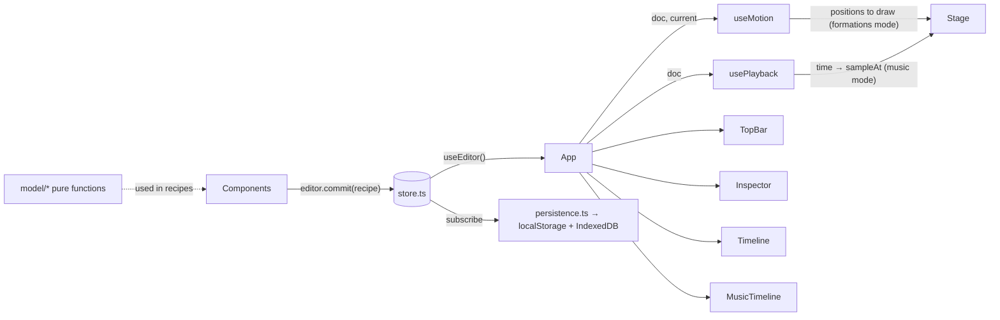

# Unison architecture

This is the complete map of how Unison is built. It must always match the code. **If you change the code, update this file in the same change** (see [AGENTS.md](../AGENTS.md)). If you ever find a mismatch, the code is the source of truth: fix this document.

## 1. What it is and how it runs

Unison is a client-only React app for planning dance formations and timing them to music. There's no server, no account, and no network access at runtime.

- **Build output:** `npm run build` type-checks, then Vite bundles everything into a single self-contained file, `dist/index.html` (all JS and CSS inlined by `vite-plugin-singlefile`, `base: './'`).
- **Running it:** users double-click `dist/index.html`. It runs from `file://` in Edge, Chrome, Safari and Firefox on Windows and macOS. This is the core product requirement; see the [file:// constraints](#9-hard-constraints) below.
- **Development:** `npm run dev` serves the same app with hot reload at `http://localhost:5173`.

### Tech stack

| Piece | Choice | Notes |
| --- | --- | --- |
| Language | TypeScript 7 | `tsc -b` runs before every build. |
| UI | React 19 | Function components and hooks only. |
| Build | Vite 8 + `@vitejs/plugin-react` + `vite-plugin-singlefile` | Configured in `vite.config.ts`. |
| Tests | Vitest 5 | Unit tests for model and store code (Node, no DOM). |
| Lint | Oxlint | Configured in `.oxlintrc.json` (React hooks rules). |
| Rendering | SVG + Canvas | The stage and thumbnails are plain SVG elements rendered by React; the music waveform is a `<canvas>`. |
| Audio | Web Audio + `<audio>` | `OfflineAudioContext.decodeAudioData` for the waveform and duration; an `<audio>` element plays the music. No libraries. |
| Styling | One global stylesheet | `src/index.css`, dark theme driven by CSS variables. |

Runtime dependencies are only `react` and `react-dom`. Everything else is a dev dependency.

## 2. Repository layout

```text
AGENTS.md                Instructions for AI agents (read first)
README.md                User and developer guide
docs/
  architecture.md        This file
  plan.md                Tech choice rationale, roadmap, open questions
  research-arrangeus.md  Research on ArrangeUs, the app Unison improves on
index.html               HTML shell: title, inline SVG favicon, #root, entry script
vite.config.ts           React plugin + single-file build
package.json             Scripts: dev, build, test, lint, check:private, preview
scripts/
  check-private.mjs      Scans files to be committed for personal or private information (see §10)
.npmrc                   Keeps package-lock.json free of registry URLs (see §10)
.gitattributes           Forces LF line endings on every OS (see §10)
.gitignore               Ignores node_modules/, dist/ and .projects/
.projects/               Local folder for your own .unison project files; git-ignored, never committed
.oxlintrc.json           Lint rules
tsconfig*.json           TypeScript project references (app = src/, node = vite.config.ts)
src/
  main.tsx               Entry: awaits the autosaved project (if any, with its music from IndexedDB), starts autosave, restores the file link and recent list, renders <App>
  App.tsx                Shows Welcome or the Editor (layout shell + global keyboard shortcuts)
  index.css              All styles
  model/                 Pure data + logic. No React, no DOM, no browser APIs except crypto.getRandomValues
    types.ts             Data types (Choreography, Dancer, Formation, Music, Point, Positions, StageSize)
    stage.ts             Stage geometry: snapping, clamping, offstage test, group drag math
    choreography.ts      Factories (new project, sample project for tests) and pure edit functions
    timing.ts            Music mode timing: where dancers are at a given time, re-timing formations
    path.ts              Custom paths: relative path points ↔ stage points, smooth/cornered routes, moving along a route
    interpolate.ts       Easing and blending positions between two formations (glides and music mode transitions)
    file.ts              Save-file serialize/parse with validation and repair
    *.test.ts            Vitest unit tests, next to the code they test
  state/                 App state and side effects
    store.ts             Global editor store: open project (or none), selection, view options, undo/redo
    persistence.ts       Autosave (localStorage + IndexedDB for audio), New/Open/Save/Save as of .unison files, add/remove music, unsaved-changes guard
    fileHandles.ts       Save in place (Edge/Chrome): file pickers, permissions, writing, linked file + recent list in IndexedDB
    db.ts                Tiny IndexedDB key-value helpers (dbGet/dbPut/dbDelete)
    audio.ts             Music: reading an audio file into the project, waveform peaks, playable blob URLs
    useMotion.ts         Hook: short glide between formations (formations mode)
    usePlayback.ts       Hook: music mode playhead, play/pause/seek, audio element
    store.test.ts        Vitest unit tests for the store (no project open, fresh history on open, unsaved-changes tracking, close)
  components/            React UI
    Welcome.tsx          Start screen while no project is open: New project / Open project… / recent projects
    TopBar.tsx           App name, project name, save status, Formations | Music mode switch, undo/redo, New/Open/Save as/Save
    OpenMenu.tsx         Top-bar "Open ▾" dropdown (Open a file… + recent projects), used once there are recent projects
    RecentList.tsx       List of recent projects (one click to reopen, × to remove), shared by Welcome and OpenMenu
    Stage.tsx            SVG stage: grid, wings, dancers, ghosts/paths, drag and box select
    Timeline.tsx         Formations mode bottom bar: prev/next, "Formation N of M", formation strip with thumbnails
    MusicTimeline.tsx    Music mode bottom bar: transport, music file, waveform, draggable formation blocks, playhead
    Inspector.tsx        Right panel: formation (+ start/end in music mode), selected dancers, dancer list, stage and view options, shortcuts
    Icon.tsx             Inline SVG icons (<Icon name=…>) and the logo
    ui.ts                Small UI helpers: shortcut labels, text color on a swatch, selection toggle, time formatting
```

## 3. Screen layout

With **no project open**, `App` renders only the `Welcome` screen: a centered card with **New project** and **Open project…**. There's no demo or sample project at startup.

With a project open, `App` renders the editor as a CSS grid (`.app` in `index.css`) with four areas:

```text
┌──────────────────────── TopBar (top) ─────────────────────────┐
│                                               │               │
│  Stage (stage)                                │  Inspector    │
│                                               │  (side, 300px)│
├───────────────────────────────────────────────┤               │
│  Timeline or MusicTimeline (timeline)         │               │
└───────────────────────────────────────────────┴───────────────┘
```

**Two modes** (`view.mode`, switched in the top bar or with **M**):

- **Formations** (default): no time. The bottom bar is `Timeline` (formation strip), and switching formations glides dancers there.
- **Music**: formations are timed against the music. The bottom bar is `MusicTimeline`, the stage shows the piece **at the playhead**, and the Inspector adds start/end fields. See §7.

**Stage-only mode** (`view.hideBars`, toggled by the button in the stage's top-right corner or the **F** key): `.app.bars-hidden` collapses the grid to the single `stage` area and the other three regions aren't rendered, so the stage fills the window. The setting is a saved view option, so it survives reopening; the toggle button stays visible to bring the bars back. In music mode a play/pause button sits next to it.

## 4. Data model (`src/model/types.ts`)

```ts
Choreography { format: 'unison'; version: 3; name; stage: StageSize; dancers: Dancer[]; formations: Formation[]; music?: Music }
StageSize    { width; depth; grid }           // feet; width/depth = performance area only (wings are extra); grid = side of each grid square
Dancer       { id; name; label; color }       // label = 1–3 chars drawn in the marker; color = #rrggbb
Formation    { id; name; positions: Positions; notes; start; end; paths: Record<dancerId, Path> }   // start/end = seconds, music mode only; paths = how dancers get here from the previous formation
Path         { points: PathPoint[]; corners }   // corners = straight segments with sharp corners instead of a smooth curve
PathPoint    { along; across }   // relative to the straight line from start spot to end spot: along = fraction of the way, across = feet to the right of travel (as seen on screen)
Music        { id; name; type; duration; data }   // embedded audio file: name = original file name, type = MIME type, duration = seconds, data = base64
Positions    = Record<dancerId, Point>
Point        { x; y }
```

### Coordinate system

- Units are **feet**, origin at **center stage**. (Files before version 2 used meters and are converted when opened.)
- **+x is the audience's right** (which is *stage left*); **+y is downstage**, toward the audience.
- The performance area spans `x ∈ [-width/2, width/2]`, `y ∈ [-depth/2, depth/2]`.
- Offstage **wings** (`WING = 6` ft) extend each side, so dancers can be placed at `|x| ≤ width/2 + 6`. A dancer with `|x| > width/2` is offstage and is drawn dimmed. There's no upstage or downstage wing.
- Positions are absolute feet, so resizing the stage doesn't move anyone. Dancers can end up outside a smaller stage; nothing clamps them until they're dragged.

### Invariants

- Every formation has a position for **every** dancer. Adding a dancer adds them to all formations; removing one removes them from all.
- Dancer names, labels and colors are **per piece**, not per formation.
- There's always **at least one** formation.
- Formation `name` may be empty; the UI shows `Formation N` instead (`formationTitle`).
- **Timing (music mode):** each formation is a block from `start` to `end` seconds where dancers hold still; they move during the gap until the next formation's `start`. Blocks never overlap and stay in order: `0 ≤ start ≤ end ≤ next.start`. A zero-length block (pass-through) and a zero gap (instant change) are allowed. Formations mode ignores timing, but every edit keeps it valid. Times are rounded to milliseconds.
- **Music** is optional and embedded in the document (base64), so a `.unison` file is self-contained. It's about a third bigger than the audio file. Music changes (add, replace, remove) are undoable like any edit.
- **Custom paths:** by default a dancer moves in a straight line from their spot in one formation to their spot in the next. `formation.paths[dancerId]` (on the **later** formation) can route them through any number of points instead, as a smooth curve or with sharp corners. Points are stored **relative to the straight line** between the two spots, not as stage coordinates, so when either spot moves (dragging a dancer, reordering formations, deleting the formation in between) the path keeps its shape and still starts and ends at the dancer. (ArrangeUs stores fixed curves that "go stale" after such edits.) A dancer who stays put has no direction of travel, so their points are measured in feet from the spot (+x, +y) instead. A path with no points and smooth style is the same as no path and is never stored; a path with no points but `corners: true` is kept so the chosen style survives straightening.
- Ids come from `uid()` (16 hex chars from `crypto.getRandomValues`). Don't use `crypto.randomUUID`; some browsers don't expose it on `file://`.

## 5. Model layer (`src/model/`)

All functions are **pure**: they never mutate inputs and return new objects. Edit functions that change nothing should return the **same** object, which lets the store skip creating an undo step.

### `stage.ts`

| Export | Purpose |
| --- | --- |
| `snapStep(stage)` | Half a grid square (`stage.grid / 2`): dancers snap to grid lines and square centers. Also the keyboard nudge step (Shift+arrow nudges a whole square). |
| `gridSize(feet)` | Rounds a square size to the nearest half foot within `MIN_GRID`–`MAX_GRID` (1–20 ft). |
| `WING = 6` | Width of each side wing in feet. |
| `DANCER_RADIUS = 0.85` | Marker radius in feet (1.7 ft across). Used for drawing, thumbnails and trimming path lines; label font sizes in `Stage.tsx` scale with it. |
| `DEFAULT_STAGE`, `MIN_STAGE`, `MAX_STAGE` | New-project stage (40 × 24 ft with 2 ft squares) and the allowed width/depth range (6–200 ft). |
| `FEET_PER_METER` | Converts version 1 (meter) files when they're opened. |
| `gridLines(half, step)` | Positions every `step` feet from center outward within `±half` (used for grid lines and `addDancer`'s candidate spots, with `step = stage.grid`). |
| `clamp`, `snap`, `tidy` | Number helpers. `tidy` rounds to 3 decimals so saved files don't contain float noise. |
| `isOffstage(p, stage)` | `|x| > width/2`. |
| `snapPoint(p, stage)`, `clampToFloor(p, stage)` | Snap a point to the half-square snap grid; keep it on the stage or in the wings. Used for path points. |
| `shift(positions, ids, offset)` | New positions for `ids` moved by `offset` (tidied). |
| `dragOffset(positions, ids, anchor, delta, stage, snapping)` | Offset to apply to a group drag. With snapping, the **grabbed dancer** (`anchor`) lands on the snap grid and the group moves rigidly with it. The group is clamped so nobody leaves the wings horizontally or the stage depth vertically. Also used (without snapping) for keyboard nudges. |

### `choreography.ts`

| Export | Purpose |
| --- | --- |
| `PALETTE` | 12 default dancer colors, assigned round-robin. |
| `uid()` | Random id (see invariants). |
| `formationTitle(f, i)` | Display name with the `Formation N` fallback. |
| `createDancer(i)`, `createFormation(name, positions, start = 0)` | Factories. A new formation's block is `HOLD` (4 s) long from `start`. |
| `lineUp(count, stage)` | Starting positions: centered rows, 6 ft or 4 ft apart (whichever fits across the stage first), else 2 ft apart in several rows. Spacings are even so everyone lands on whole feet (on the snap grid for the default 2 ft squares). |
| `createChoreography(n)` | New project: 40 × 24 ft stage, `n` dancers lined up, one formation (0–4 s), no music. |
| `createDemo()` | Sample project (6 named dancers Ava…Fay, 4 formations: line, V, circle, exit to wings, timed 0–4, 6–10, 12–16, 18–22 s). Used by unit tests; the app never loads it. |
| `setPositions(doc, i, updates)` | Merge position updates into formation `i`. |
| `updateFormation(doc, i, patch)` | Patch `name`, `notes`. |
| `updateDancers(doc, ids, patch)` | Patch `name`, `label`, `color` on several dancers. |
| `addDancer(doc, i)` | Adds a dancer at the free grid-line intersection nearest center stage (at least 4 ft from everyone in formation `i`), at that **same spot in every formation**. Returns `{ doc, id }`. |
| `removeDancers(doc, ids)` | Removes dancers and their positions and paths everywhere. |
| `duplicateFormation(doc, i, start?)` | Inserts a copy right after `i` (new id, empty name and notes, **no paths**: the copy is in the same spots, so nobody moves into it). This is what "+ Formation" and "Duplicate" do. The copy's block starts at `start` (default: `GAP` = 2 s after `i` ends; never before `i` ends) and lasts `HOLD`. Later formations are shifted later (all by the same amount, keeping their spacing) only if the next one would start less than a `GAP` after the copy ends. The formation after the copy keeps its paths, which now start from the copy's (identical) spots. |
| `setPathPoint(doc, i, dancer, point, value, insert)` | Sets path point `point` of `dancer`'s path into formation `i`, or inserts a new one there when `insert`. |
| `removePathPoint(doc, i, dancer, point)` | Removes a path point. |
| `setPathCorners(doc, i, dancers, corners)`, `straightenPaths(doc, i, dancers)` | Path style (smooth or sharp corners), and removing all points (keeping the style), for several dancers' paths into formation `i`. All path edits drop paths that end up straight and smooth. |
| `removeFormation(doc, i)` | No-op when only one formation is left. Leaves a gap in time (later formations don't move). |
| `moveFormation(doc, from, to)` | Reorder; no-op when `to` is out of range. **Time slots stay where they are**: formations swap places, but each position in the order keeps its `start`/`end`, so the piece still lines up with the music. Paths stay with their formation (now starting from a different previous formation; being relative, they still connect the right spots). |

### `timing.ts`

Music mode timing. Pure functions over the timing invariants in §4.

| Export | Purpose |
| --- | --- |
| `HOLD`, `GAP` | Defaults: 4 s block, 2 s gap. |
| `roundTime(t)` | Rounds to ms, never below 0. |
| `defaultStart(i)` | `i × (HOLD + GAP)`: back-to-back default timing. |
| `sampleAt(formations, t)` | `{ index, positions, moving }` at time `t`: inside a block that formation's positions; in a gap the eased (`ease`) move toward the next formation along its custom paths (`moving: true`); before the first block the first formation, after the last block the last one. `index` is the formation reached most recently. |
| `pieceLength(doc)` | Later of the music's end and the last formation's end. Playback stops here. |
| `earliestStart(doc, i)` | Sum of the lengths of formations before `i`: the earliest `i` can start if everything before it is packed from 0. |
| `retime(doc, i, start, end)` | Sets formation `i`'s block (start ≥ `earliestStart`, end ≥ start). Neighbors it would overlap are **pushed** out of the way keeping their lengths (later ones later, earlier ones earlier), and the push stops at the first neighbor that doesn't overlap. Returns `doc` unchanged if nothing changes. Used by block drags, the start/end fields and `[`/`]`. |
| `shiftFrom(doc, i, seconds)` | Moves formations `i…` later by `seconds` (no-op for ≤ 0). |

### `interpolate.ts`

| Export | Purpose |
| --- | --- |
| `ease(t)` | Cosine ease-in-out on `[0, 1]`. |
| `interpolate(from, to, t, paths?, backward?)` | Positions `t` of the way from `from` to `to` (dancers missing from `from` stay at their `to` position). Dancers without a path in `paths` move in a straight line; dancers with one move along its `route`, by distance (`pointAlong`). `paths` are always the **later** formation's; with `backward` (`from` is the later formation), dancers travel the same route in reverse. Used for the formations mode glide and for music mode transitions. |

### `path.ts`

| Export | Purpose |
| --- | --- |
| `toStage(point, a, b)`, `fromStage(q, a, b)` | Convert between a `PathPoint` and stage feet for a move from `a` to `b` (see the custom paths invariant in §4). `fromStage` rounds to 3 decimals. |
| `controlPoints(a, b, path?)` | `[a, …path points on stage, b]`. |
| `route(a, b, path?)` | The polyline the dancer travels: `[a, b]` without points; the control points with `corners`; otherwise a **centripetal Catmull-Rom** curve through every control point (no loops or overshoot, unlike the uniform kind), sampled 16 times per piece, with the ends extended straight so it starts and ends naturally. |
| `pieceMidpoints(a, b, path?)` | Halfway point of each piece of the route between consecutive control points (where the "bend here" handles go). |
| `routeLength(points)`, `pointAlong(points, fraction)`, `sliceRoute(points, from, to)` | Length; the point a fraction of the way along by distance (so dancers keep an even pace around curves); the part between two distances (to trim guide lines at the markers). |

### `file.ts`

- `serialize(doc)`: pretty-printed JSON of the `Choreography` object, as is (the music's base64 data is one long string).
- `parseMusic(value)`: validates embedded music; returns `undefined` unless `data` is a non-empty string. Fills in a missing id, name (`Music`), type (`audio/mpeg`) or duration (0).
- `parseChoreography(json)`: throws a readable `Error` for invalid JSON, `format !== 'unison'`, or a `version` other than 1–4 (a newer version says it may need a newer copy of Unison). **Version 1 files were in meters**: their stage size and positions are multiplied by `FEET_PER_METER` (positions tidied to 3 decimals, stage sizes rounded to whole feet). The result is always version 4. Otherwise it **repairs** rather than rejects: stage sizes are rounded and clamped to 6–200 ft (default 40 × 24); the grid square size goes through `gridSize` (default 2 ft when missing, e.g. in files from before the setting existed or version 1 files); dancers without a string id or with a duplicate id are dropped, and missing name/label/color are filled in (label truncated to 3 chars); a formation's missing positions come from the previous formation, else from `lineUp`; positions for unknown dancers are dropped; duplicate or missing formation ids get a new `uid()`; **timing**: a missing or invalid (negative, non-number) `start` defaults to a `GAP` after the previous formation's end (0 for the first), a missing `end` to `start + HOLD`, and overlaps are repaired by moving `start` up to the previous end and `end` up to `start` (so version 1/2 files get back-to-back default blocks); `hold`/`transition` fields from version 1 (and any other unknown fields) are dropped; an empty formation list gets one lined-up formation; `music` goes through `parseMusic` and is omitted when invalid; **paths** are kept only for known dancers, keeping only points whose `along` and `across` are finite numbers (tidied), with `corners` true only if exactly `true`, and dropped when they end up straight and smooth (files before version 4 have none).

## 6. State layer (`src/state/`)

### `store.ts`: the editor store

A single module-level store read in React through `useEditor()` (`useSyncExternalStore`).

```ts
EditorState   { doc: Choreography | null; savedDoc: Choreography | null; fileName: string | null; recent: RecentProject[]; opened: number; current; selection: string[]; view: ViewOptions; past: Snapshot[]; future: Snapshot[] }
RecentProject { handle: FileSystemFileHandle; projectName }   // project name as of the last open/save of that file
OpenState   = EditorState & { doc: Choreography }   // narrowed with isOpen(state)
ViewOptions { snap; names; prevPaths; nextPaths; hideBars; mode: 'formations' | 'music' }   // hideBars = stage-only mode, mode = see §3
Snapshot    { doc; current }
```

`doc` is `null` until the first project is created or opened (or restored from autosave), and again after the project is closed (clicking the logo). `opened` counts `open()` and `close()` calls; `App` uses it as the `Editor`'s React `key`, so per-project screen state (glide, playhead, audio) starts fresh with each project.

**Unsaved changes:** `savedDoc` is the document as last opened from or saved to a file (`null` if it never was). `hasUnsavedChanges(state)` is simply `doc !== savedDoc`. Because documents are immutable, undoing back to the saved version makes the project "saved" again. `fileName` is the name of the linked file Save writes to (Edge/Chrome only; `null` otherwise). `recent` is the recent-projects list (Edge/Chrome only; always empty elsewhere). None of these are part of undo history.

| Method | Behavior |
| --- | --- |
| `init(doc, view, savedDoc?)` | Called once in `main.tsx` before rendering, with the autosaved project (or `null`) and, if it had no unsaved changes, the same doc as `savedDoc`. |
| `commit(recipe, coalesce?)` | **The only way to change the document.** No-op when no project is open. Applies `recipe(doc)`; if it returns the same object, nothing happens. Otherwise pushes the previous `{ doc, current }` onto `past` (max 200), clears `future`. Consecutive commits with the same non-undefined `coalesce` key merge into one undo step (used for typing and number fields; keys look like `name:<formationId>`, `nudge:<index>:<ids>`). |
| `open(doc, fileName, saved)` | Shows `doc` as the open project with a **fresh undo history**, resets `current` and the selection, and sets `fileName` and `savedDoc` (`doc` if `saved`, else `null`). Opening is deliberately not undoable: otherwise undo could bring back a different project while Save still points at the newly opened file and overwrite it. Unsaved work is protected by a confirmation in `persistence.ts` instead. |
| `markSaved(doc, fileName)` | Records that `doc` (the version that was written, which may be older than the current doc if the user kept editing during the write) is saved, and the linked file name. |
| `setFileName(name)` | Used when the remembered file link is restored after startup. |
| `setRecent(list)` | Replaces the recent-projects list (only `persistence.ts` calls it). |
| `close()` | Closes the project: `doc`, `savedDoc` and `fileName` become `null` and history is cleared, so `App` shows the welcome screen. |
| `undo()` / `redo()` | Restore a snapshot, including which formation was current. Reset coalescing. |
| `setCurrent(i)`, `select(ids)`, `setView(patch)` | Not undoable. |

While a project is open, every state change clamps `current` to a valid index and, when the document changed, drops selected ids that no longer exist.

### `persistence.ts`

- **Project files:** a project is saved as `<project name>.unison` (`FILE_EXTENSION`), containing `serialize(doc)` JSON (see §8). The file name is the project name stripped of characters that are invalid in file names, max 80 chars, fallback `Untitled`.
- **Two ways of saving**, chosen by `supportsFileHandles` (from `fileHandles.ts`):
  - **Edge and Chrome (save in place):** Open uses the browser's file picker and keeps the file's handle as the **linked file** (module variable `linkedFile`; the store only holds its name). **Save** writes straight back to the linked file. **Save as…** asks for a new location (suggested name `<project name>.unison`, same remembered folder as Open), writes there, and makes it the linked file. Save without a linked file (a new project) behaves like Save as. If the linked file was moved or deleted, Save falls back to Save as; if the user refuses write permission, an alert explains it and suggests Save as.
  - **Safari and Firefox (no file access API):** Open uses a hidden `<input type=file accept=".unison">`; Save downloads `<project name>.unison` through a Blob link (type `application/octet-stream`, so browsers keep the exact name instead of appending `.json`). There's no Save as… button; nothing is ever linked.
- **Remembering the linked file:** whenever the linked file changes, its handle is stored in IndexedDB (`rememberFile`; `null` deletes it). On startup, `restoreFileLink()` (called from `main.tsx`) re-links it if a project was restored, so Save keeps writing to the same file after the browser is reopened. The browser asks for write permission again on the first Save of a new session. A `generation` counter, bumped whenever the project is replaced, stops slow async work (restoring the link, writing a file) from applying to a project that was replaced in the meantime.
- **New / Open** go through `replaceProject`, which updates `linkedFile` (null for New and for fallback Open) and calls `editor.open`. Both first call `okToReplace()`: if the project has unsaved changes, a `confirm` asks before discarding them. New prompts for 1–100 dancers → `createChoreography` (not saved: `savedDoc` is null). Open errors are shown with `alert`.
- **Close** (`closeProject()`, the top-bar logo): also asks via `okToReplace()`, then unlinks the file (and forgets it in IndexedDB) and calls `editor.close()`. Autosave then removes the saved project from `localStorage`, so reopening the page shows the welcome screen too.
- **Recent projects (Edge and Chrome):** opening a file, Save and Save as each call `addRecent(file, projectName)`, which moves that file to the top of the list (deduplicated with `isSameEntry`, max 8) and stores the list in IndexedDB. `loadRecent()` (from `main.tsx`) loads it at startup. `openRecent(entry)` reopens a project **without a file window**: after `okToReplace()`, it asks for read-write permission (no prompt within a session where it's already granted; one browser prompt after a restart, which also covers later saves), reads and parses the file, and links it. If the file was moved or deleted, an `alert` says so and the entry is dropped. `forgetRecent(entry)` removes one entry. The reason for this feature: the Windows file dialog itself takes about 1 s to open and another ~0.9 s to close (measured the same for the file-access picker and a plain file input), so skipping it is the only way to make reopening fast.
- **Autosave:** `startAutosave()` subscribes to the store and, 400 ms after the last change to `doc`, `savedDoc` or `view`, writes `localStorage` keys `unison.autosave.v1` (the project, only when one is open), `unison.unsaved.v1` (`'0'` if it matches its file, `'1'` if not) and `unison.view.v1`. When no project is open, it removes the first two keys instead. Write errors are ignored. **Audio is too big for localStorage** (a few MB at most), so the project is stored there with `music.data` emptied, and the audio itself goes to IndexedDB (key `autosave-music`, value `{ id, data }`) only when the music changes (by `music.id`); removing the music deletes the key.
- **Startup** (`main.tsx`, which awaits it before the first render): `loadAutosave()` returns the saved project, whether it had unsaved changes (missing flag counts as unsaved), and `lostMusic`; or `null` (nothing saved, or unreadable), in which case the welcome screen shows. So whatever project was open last time comes back when the page is reopened, still marked saved or unsaved. If the saved project had music, its audio is read back from IndexedDB and matched by id. **If that fails** (`lostMusic`), the project comes back without music and marked unsaved, `main.tsx` doesn't re-link its file (so Save can't overwrite the file without its music), and an alert says to reopen the project file. `loadView()` merges saved view options over the defaults (`snap`, `names`, `prevPaths` on; `nextPaths`, `hideBars` off; `mode: 'formations'`, any other saved mode value becomes `'formations'`).
- **Music:** `addMusic()` asks for an audio file (`<input type=file accept="audio/*,.mp3,.m4a,…">`, every browser), turns it into `Music` with `readMusicFile` (rejected with an alert if the browser can't decode it), and commits it as the project's music, replacing any old music. Guarded by `generation`, so music picked for a project that was replaced meanwhile is dropped. `removeMusic()` commits `music: undefined`. Both are undoable.
- `canAutosave` probes `localStorage` once; when it's unavailable (some browsers on `file://`), `Welcome` and `TopBar` show a warning.

### `db.ts`

`dbGet(key)`, `dbPut(key, value)`, `dbDelete(key)` on IndexedDB database `unison`, object store `files` (named before it held anything but file handles). Each call opens and closes the database. Callers handle errors. Keys: `current` (linked file), `recent` (recent projects), `autosave-music` (autosaved audio).

### `audio.ts`

| Export | Purpose |
| --- | --- |
| `readMusicFile(file)` | Decodes the file (proving the browser can play it, and getting its exact duration), base64-encodes it (`FileReader.readAsDataURL`), and returns `Music` with a new id. Caches the waveform it computed along the way. |
| `musicPeaks(music)` | Waveform: `Float32Array` of the loudest sample (0–1, all channels) per 1/`PEAKS_PER_SECOND` (100) s. Decoded once per music id and cached as a promise. Decoding uses an `OfflineAudioContext`, which needs no user gesture and plays nothing. |
| `musicUrl(music)` | Blob URL for an `<audio>` element. Cached per music id for the session (never revoked), so undo/redo between songs is instant. |

### `fileHandles.ts`: save-in-place helpers

Thin wrapper over the File System Access API (`showOpenFilePicker`, `showSaveFilePicker`, `createWritable`, `queryPermission`/`requestPermission`), which only Chromium browsers (Edge, Chrome) have. It works on `file://` pages there. The API isn't in TypeScript's DOM types, so the needed shapes are declared locally.

| Export | Purpose |
| --- | --- |
| `supportsFileHandles` | Both pickers exist. Everything else is only called when this is true. |
| `pickFileToOpen(ext)`, `pickFileToSave(ext, suggestedName)` | Pickers filtered to `.unison`, sharing picker id `unison-projects` so the browser remembers the last folder. Return `null` when the user cancels. |
| `ensurePermission(handle, mode)` | Checks `'read'` or `'readwrite'` permission and asks the user if needed; returns `false` if refused. |
| `writeFile(handle, text)` | `ensurePermission(handle, 'readwrite')`, then overwrites the file. Returns `false` if permission was refused. |
| `rememberFile(handle \| null)`, `recallFile()` | Store/load the linked file handle in IndexedDB (`db.ts`, key `current`). Failures are swallowed; the only effect is that Save asks where to save. |
| `saveRecentProjects(list)`, `loadRecentProjects()` | Store/load the recent-projects list (key `recent`). Failures are swallowed; the list just won't survive a restart. |

### `useMotion.ts`: what the stage shows in formations mode

`useMotion(doc, current)` returns the positions to draw. Internal state is one `Glide` or `null`:

- `goTo(i)`: sets `current` to formation `i` and starts a 450 ms eased glide (`requestAnimationFrame`) from whatever is on screen (even mid-glide) to that formation. This is a fixed-speed preview, not a timing setting. Stepping to the **next** formation follows its custom paths; stepping to the **previous** one follows the current formation's paths in reverse; jumping further glides in straight lines.
- `stop()`: drops any glide immediately (used when the user starts editing, or before New/Open).

Returned values: `positions`, `moving` (a glide is running), `goTo`, `stop`.

### `usePlayback.ts`: the music mode playhead

`usePlayback(doc)` returns `{ time, playing, length, seek, play, pause, toggle }`. `time` is the playhead in seconds (React state, updated every animation frame while playing); `length` is `pieceLength(doc)`.

- **Clock:** while the music is actually playing, the `<audio>` element's `currentTime` is the clock, so the stage stays in sync with what you hear. Otherwise (no music, or past the music's end, or before audio starts) the system clock (`performance.now`) advances from the last known time. Playback stops at `length`; Play at the end starts again from 0.
- **Audio element:** one per music id, created (and preloaded) when the music appears, from `musicUrl`. Replaced or removed music restarts the playing effect so the new audio is used.
- `seek(t)` (clamped to ≥ 0; can go past the end so formations can be added there) updates the time, re-anchors the system clock and, while playing, moves the audio too.
- The hook lives in `Editor`, which is keyed by `state.opened`, so a new project starts at 0 with no audio playing; unmounting pauses the audio.

## 7. UI layer

### Data flow



`App` is the only component that calls `useEditor()`. It renders `Welcome` when `isOpen(state)` is false, otherwise the internal `Editor` component (keyed by `state.opened`) with an `OpenState`. Editor children get state via props and call `editor.*` methods directly to make changes; `useMotion` and `usePlayback` live in `Editor`, so they only run while a project is open.

### `App.tsx`

`Editor` wires the four regions together (or only the stage when `view.hideBars` is on; the TopBar, Inspector and bottom bar then aren't rendered at all), picks the bottom bar by mode (`Timeline` or `MusicTimeline`), renders the floating **bars toggle** button in the stage's top-right corner (always visible, so the bars can be brought back; in music mode with the bars hidden a play/pause button sits next to it), defines `goTo`, `prepareEdit`, `addFormation` and `mark` (see "Music mode wiring" below) and handles global keyboard shortcuts with one `keydown` listener on `window` (via `useEffectEvent`). The welcome screen has no keyboard shortcuts.

| Keys | Action | Notes |
| --- | --- | --- |
| Ctrl/⌘+Z, Ctrl/⌘+Shift+Z, Ctrl+Y | Undo / redo | Handled even while typing in a field (replaces the browser's text undo). |
| Ctrl/⌘+S, Ctrl/⌘+Shift+S, Ctrl/⌘+O | Save / Save as / Open | Also handled while typing. |
| Ctrl/⌘+A | Select all dancers | Ignored while typing (normal text select-all). |
| Esc | Clear selection | |
| F | Hide / show the bars (stage-only mode) | Toggles `view.hideBars`. |
| M | Switch formations / music mode | Toggles `view.mode`. |
| Space | Play / pause | Music mode only. `preventDefault` stops it also clicking a focused button. |
| `[` / `]` | Start / end the current formation at the playhead | Music mode only; `mark(edge)` → `retime`. `[` past the end moves the end too; `]` before the start moves the start too. |
| Home | Playhead to 0 | Music mode only. |
| Delete / Backspace | Remove selected dancers | |
| Arrows | With a selection: nudge half a grid square (Shift: a whole square), clamped like a drag and coalesced into one undo step per selection. Without: ←/→ go to previous/next formation. | |

All shortcuts except undo/redo/save/open are ignored while focus is in an `input`, `textarea`, `select` or `contenteditable` element.

#### Music mode wiring (in `Editor`)

- `usePlayback(doc)` always runs; in music mode the stage draws `sampleAt(doc.formations, playback.time)` instead of `useMotion`'s positions, and guides hide while playing or between blocks.
- **Playhead → current formation:** whenever the playhead **time** changes (playing, seeking, scrubbing), the formation it's in (`sample.index`) becomes current. Edits that don't move the playhead never change the current formation, so dragging the current formation's block away from the playhead keeps it selected.
- **Current formation → playhead:** `goTo(i)` (formation buttons, ←/→, clicking a block, the Inspector's move buttons, after adding) makes `i` current and seeks to its `start`. In formations mode `goTo` is `useMotion`'s glide. Entering music mode seeks to the current formation's start; leaving it pauses.
- `prepareEdit()` (before a stage pointer gesture or a nudge): stops any glide; in music mode also pauses and, if the playhead isn't inside the current formation's block (another formation, or between blocks), seeks to its start, so you always edit what you see.
- `addFormation()`: in formations mode duplicates the current formation and glides to it. In music mode it pauses and duplicates the formation at the playhead (`sample.index`), starting **at the playhead** if the playhead is past that formation's end, else a `GAP` after it (see `duplicateFormation`), then goes to the copy.

### `Stage.tsx`

- Draws in SVG user units with `U = 12` units per foot (large enough units keep text crisp and above browsers' minimum font sizes). The `viewBox` covers the stage, both wings and margins for labels; the SVG scales to fill its area. Label margins and offsets are fixed SVG units, not feet, so labels look the same on any stage size.
- Layers, back to front: wings with "STAGE RIGHT"/"STAGE LEFT" labels (stage right is on the audience's left), floor, grid lines every `stage.grid` feet (`gridLines`, center lines dashed), floor border, front-edge stage numbers (distance from center) on every grid line, or on every 2nd/3rd… line when squares are under 2 ft so numbers never sit closer than 2 ft apart, "UPSTAGE"/"AUDIENCE" labels, ghost guides, dancers, selection marquee.
- **Dancers:** a `<g data-dancer=id>` with selection ring, colored circle, label (text color picked for contrast by `inkFor`, font shrinks for 3-char labels) and optional name. Offstage dancers are dimmed. The label is **optically centered**: `labelOffset` measures the label's actual glyph bounds with a canvas `measureText` (at 1000 px, then scaled, because browsers round metrics to whole pixels at small sizes; cached per text) and places its alphabetic baseline so the visible ink is centered. Plain `dominant-baseline: central` centers the em box instead and left digits and capitals about 8% of the radius too low.
- **Guides:** when `prevPaths`/`nextPaths` are on, each dancer gets a dashed ghost circle at their previous/next position and their route (straight or custom, as a `<polyline>`) trimmed by the marker radius at both ends. **A selected dancer always shows the route into the current formation**, even with `prevPaths` off, so its path can be edited. Guides are hidden while anything is moving. Routes are computed from the positions on screen, so they follow a dancer being dragged.
- **Path handles** (`PathHandles`, drawn above the dancers, for selected dancers when nothing is moving and no dancer drag is in progress): on the route into the current formation, and on the route to the next one when `nextPaths` is on. A hollow handle sits halfway along each piece of the route (`pieceMidpoints`); dragging it **inserts** a path point there. A filled handle sits on each path point; dragging moves it. Handles within 1.6 marker radii of either end are hidden so they never block grabbing the dancer. Each handle carries `data-path` (`add`/`point`), `data-formation` (the later formation, whose `paths` it edits), `data-path-dancer` and `data-point`.
- **Pointer gestures** (pointer capture on the SVG). Any pointer down first calls `onEditStart` (`prepareEdit`). Then:
  - Shift/Ctrl/⌘+click a dancer toggles it in the selection.
  - Pressing a dancer starts a **drag** of the selection (or just that dancer if it isn't selected). While dragging, positions are previewed locally with `dragOffset`; on release the move is committed once (if it moved more than 0.15 ft).
  - Pressing empty space starts a **box select** (added to the current selection when a modifier key is held); dancers inside the box (using the positions on screen) are selected live.
  - Pressing a **path handle** starts a path gesture (selection doesn't change). Each move converts the pointer position (snapped to the half-square grid when snapping is on, kept on the floor) to a `PathPoint` with `fromStage` and commits `setPathPoint` with a per-gesture coalesce key, so one drag is one undo step; a hollow handle inserts its point on the first move. Two presses on the same path point within 400 ms remove it (counted on pointer down, because pointer capture keeps `dblclick` from reaching the handle).
  - The current gesture is kept in both a ref (read by handlers, always fresh) and state (for rendering).

### `Timeline.tsx` (formations mode)

Navigation row (previous and next formation buttons, "Formation N of M") and a horizontally scrolling strip of formation cards. Each card shows a memoized SVG `Thumbnail`, number, title and a "Has notes" marker; the current card scrolls into view. The last item is the "+ Formation" card.

### `MusicTimeline.tsx` (music mode)

- **Transport row:** Play/Pause, clock (`m:ss.hh / length`), previous/next formation, "Formation N of M", **[ Start here** / **End here ]** (same as `[`/`]`), **+ Formation** (at the playhead), then the music's file name with **Replace…** / **Remove**, or **Add music…** when there's none, and zoom −/+.
- **Lanes** (one horizontally scrolling box): a time **ruler** (step chosen from 0.5 s…10 min so labels are ≥ 64 px apart), the **waveform**, a row of **formation blocks** (number + title; the current one highlighted) with a dashed line across each gap (time spent moving), and the **playhead** (amber line).
- **Zoom** is pixels per second (`pps`, 2–400). It starts as "fit": the whole piece plus 8 s (at least 20 s) fits the width. The −/+ buttons zoom around the playhead (or the middle of the view); Ctrl/⌘+scroll zooms around the pointer; plain vertical scrolling scrolls sideways. A layout effect keeps the anchored time under the same screen x after a zoom. The view follows the playhead when it moves out of view (not while dragging or scrubbing).
- **Waveform:** a `<canvas>` in a `position: sticky` lane as wide as the visible area, redrawn (device-pixel-ratio aware) on scroll, resize and zoom from `musicPeaks`, one column per pixel using the loudest peak in that column's time range. Its color comes from the CSS `color` of `.wave`.
- **Pointer gestures** (pointer capture on the lanes; presses on the lanes' own scrollbar are ignored):
  - On empty lane space: **seek**, and keep seeking while dragging (scrubbing).
  - On a block: it becomes current (without moving the playhead). Releasing without moving (< 3 px) is a click: `onSelect` → seek to its start. Moving drags it: pauses playback, then each move re-times **from the piece as it was when the drag began** (`retime(origin, …)`, so pushed neighbors spring back if you drag back) and commits with a per-drag coalesce key (one undo step). The 6 px **edges** resize (start can't pass end); the body moves the whole block (keeping its length, not before `earliestStart`). Dragged edges **snap to the playhead** within 8 px; when moving, whichever end is nearer snaps.

### `Inspector.tsx`

Sections, top to bottom:

1. **Formation:** name, notes; in music mode **Starts at / Ends at** (seconds, `NumberField` with `commitOnBlur`, then `retime`, which pushes neighbors) and a hint with the hold length and the time to move to the next formation; move earlier/later (via `onSelect`, so music mode follows with the playhead), Duplicate (`onAddFormation`), Delete.
2. **Selected dancer(s)** (only with a selection): name and label (single selection only), palette swatches and a custom color input; from the second formation on, the **path here from the previous formation**: a Smooth / Corners switch (`setPathCorners`; shows Corners when every selected dancer's path has corners) and **Straighten** (`straightenPaths`; enabled when any selected path has points), with a hint on how to bend paths; remove.
3. **Dancers** list (click to select, modifier-click to toggle) and **Add dancer** (adds near center of the current formation and selects them).
4. **Stage & view:** width/depth (6–200 ft, whole feet), **grid square size** (1–20 ft in half-foot steps, rounded by `gridSize`; one coalesced undo step per edit), and the four view toggles. The shortcut list shows the current nudge sizes.
5. **Keyboard shortcuts** (collapsible; music mode adds its keys).

`NumberField` keeps the raw text while typing so a field can be cleared and retyped; it only commits valid, clamped numbers. Normally it commits on every valid keystroke; with `commitOnBlur` (the timing fields) it commits only on Enter or leaving the field, because a half-typed time (e.g. "4" on the way to "45") would push neighbors around. Text and number edits use coalesce keys so each field edit is one undo step.

### `TopBar.tsx`, `OpenMenu.tsx`, `RecentList.tsx`, `Welcome.tsx`, `Icon.tsx`, `ui.ts`

- `Welcome`: logo, one-line description, **New project** and **Open project…** (same `newPiece`/`openPiece` as the top bar), the **Recent projects** list when there is one (`App` passes `state.recent`), a note that projects save as `.unison` files and the open project is restored next time, and the autosave warning when needed.
- `TopBar`: logo and name (a button: closes the project and returns to the welcome screen via `closeProject`), editable project name, save status (`● Unsaved changes` in amber, otherwise `Saved to <file>` when a file is linked, else `Saved`), the **Formations | Music** mode switch (`aria-pressed` buttons), autosave warning when needed, undo/redo, New, Open (a plain **Open…** button, or the `OpenMenu` dropdown once there are recent projects), Save as… (only when `supportsFileHandles`), Save (tooltip names the linked file). Calls `onBeforeReplace` (stop motion) before New/Open.
- `OpenMenu`: **Open ▾** button with a dropdown containing "Open a file…" (with its Ctrl/⌘+O hint) and the `RecentList`. Closes on choosing an item, clicking outside, or Esc.
- `RecentList`: one row per recent project (project name, file name underneath); clicking a row calls `openRecent`, the faded **×** calls `forgetRecent`. It stays visible (not hover-only) so it works on touch screens too.
- `Icon`: inline SVG paths (`prev`, `next`, `plus`, `minus`, `undo`, `redo`, `left`, `right`, `down`, `expand`, `collapse`, `play`, `pause`) rendered with class `glyph`; `Logo` for the brand mark.
- `ui.ts`: `shortcut('Mod+Z')` → `⌘Z` on Apple devices or `Ctrl+Z` elsewhere; `inkFor(color)`; `toggleId(ids, id)`; `formatTime(seconds, digits = 2)` → `m:ss.hh`.

### Styling (`index.css`)

Single dark theme defined by CSS variables on `:root` (`--bg`, `--panel`, `--accent`, `--floor`, …). Classes are plain and global (`.btn`, `.btn.icon`, `.btn.primary`, `.card`, `.field`, …). Button-size class `.btn.icon` and the SVG glyph class `.glyph` are deliberately different names. There's no CSS-in-JS or CSS modules. The music timeline's lane geometry (ruler 18 px, waveform 44 px, blocks below) is in CSS; `WAVE_HEIGHT` in `MusicTimeline.tsx` must match `.wave`'s height.

## 8. Project file format

A project file (`<name>.unison`) contains `serialize(doc)`, which is plain JSON:

```json
{
  "format": "unison",
  "version": 4,
  "name": "Spring show",
  "stage": { "width": 40, "depth": 24, "grid": 2 },
  "dancers": [{ "id": "3f9c…", "name": "Ava", "label": "A", "color": "#f87171" }],
  "formations": [
    { "id": "a1b2…", "name": "Opening line", "positions": { "3f9c…": { "x": -15, "y": 0 } }, "notes": "", "start": 0, "end": 4, "paths": {} },
    { "id": "d4e5…", "name": "Diagonal", "positions": { "3f9c…": { "x": -6, "y": 8 } }, "notes": "", "start": 6, "end": 10,
      "paths": { "3f9c…": { "points": [{ "along": 0.5, "across": 3 }], "corners": false } } }
  ],
  "music": { "id": "c4d5…", "name": "song.mp3", "type": "audio/mpeg", "duration": 215.3, "data": "SUQzBAAAAAAA…" }
}
```

All lengths are feet; times are seconds. `music` is optional; its `data` is the whole audio file, base64-encoded, so the project file is self-contained (and about a third bigger than the audio). Version history: **1** = meters (converted on open); **2** = feet; **3** = formation `start`/`end` and embedded `music`; **4** = custom `paths` (current). `stage.grid` was added within version 2 without a bump: files without it simply get the 2 ft default they were already using. Versions 3 and 4 were bumps because an older app would silently drop the new data (timing and music; paths) when re-saving; with the bump it refuses the file instead.

The file extension is `.unison`, but `parseChoreography` only looks at the content (`format` and `version`), not the file name. The same JSON (minus the audio data, see §6 autosave) is stored in `localStorage` for autosave. **Any change that this parser couldn't read correctly from an older file (new required fields, renamed fields, changed meaning), or that an older app would lose when re-saving, must bump `version`** and teach `parseChoreography` to migrate older versions, so existing files and autosaves keep opening. Removing a field that the parser simply ignores in older files (as with the old `hold`/`transition` times) doesn't need a bump.

## 9. Hard constraints

These keep the "double-click one file, any OS" promise. Breaking one usually works in `npm run dev` but fails in the built file.

- **Must work from `file://`:** don't fetch local files, add service workers, or rely on code splitting/lazy-loaded chunks. Imported assets must be inlined by the single-file build. No `crypto.randomUUID` (use `uid()`).
- **Storage may be unavailable:** always go through `persistence.ts`, which tolerates `localStorage` failures.
- **Cross-browser file I/O:** every file feature must work in Safari and Firefox too. The File System Access API (save in place) is only used behind `supportsFileHandles`, with the download / `<input type=file>` fallback for other browsers.
- **No runtime network access or accounts.**
- **Platform-neutral input:** Ctrl and ⌘ are treated the same; show shortcuts with `shortcut()`.

## 10. Conventions

- **Changes to the piece go through `editor.commit`** with a pure recipe built from model functions. Never mutate the doc.
- **Model code stays pure** and framework-free; put logic there when it can be unit tested.
- **Imports use explicit extensions** (`./store.ts`, `./Stage.tsx`), and type-only imports use `import type` (`verbatimModuleSyntax`). `erasableSyntaxOnly` is on, so no `enum`, `namespace` or constructor parameter properties.
- **Formatting:** no semicolons, single quotes, 2-space indent, compact one-line calls where readable.
- **Comments** only where something is non-obvious; short JSDoc on exports explains behavior, not parameters.
- **Tests:** Vitest files next to the code (`*.test.ts`), focused on behavior of the model layer and the store.
- **Line endings:** LF everywhere, enforced by `.gitattributes` (`* text=auto eol=lf`). Keep new files LF.
- **Lockfile:** `.npmrc` sets `omit-lockfile-registry-resolved=true`, so `package-lock.json` never records registry URLs (for example a company mirror). Keep it that way.
- **No personal or employer information, ever** (the full rule is at the top of [AGENTS.md](../AGENTS.md)): no names, usernames, emails, machine paths, internal URLs or credentials anywhere in the repo. `scripts/check-private.mjs` (`npm run check:private`) enforces what it can: it reads `git ls-files --cached --others --exclude-standard` (or the files passed as arguments), skips binary files and itself, and fails on email addresses, local paths, credential patterns, `"resolved"` URLs in `package-lock.json`, and link hosts missing from its `ALLOWED_HOSTS` list (lockfile links are exempt because they're npm package metadata). Names and employer details in prose can only be caught by reading the changes.

## 11. Testing and verification

| Command | What it checks |
| --- | --- |
| `npm test` | Unit tests: glide interpolation, drag snapping/clamping, file round-trip/repair/rejection (including meters conversion, default and repaired timing, embedded music, paths), music mode timing (`sampleAt`, `retime` pushing and clamping), custom paths (relative anchoring, smooth/corner routes, even pace forward and backward), formation and dancer edits (including duplicate/reorder timing and path edits), store behavior with no project / fresh history on open / unsaved-changes tracking / close. |
| `npm run lint` | Oxlint. |
| `npm run check:private` | No personal or private information in files that would be committed (see §10). Required before finishing any change. |
| `npm run build` | Type-check (`tsc -b`) + single-file build. |

There's no automated UI test suite yet. UI changes should be checked by opening the built `dist/index.html` directly (not just the dev server), because the `file://` constraints only show up there. For music mode, any short audio file works (a WAV generated by a script is enough); check adding it, playback, block dragging, saving (the file contains the audio) and reopening (autosave restores the audio).

## 12. Not implemented yet

The prototype intentionally leaves out (see [plan.md](plan.md) for the roadmap): a multi-piece library, dancer shapes and per-formation colors, counts/beats and BPM (music mode works in seconds; there's no beat grid, tap-to-mark or snapping to beats), per-dancer timing within a transition (everyone leaves and arrives together, whatever their path's length), playback speed control, video export, position tools (align, mirror, rotate…), formation presets, path presets (e.g. "arc around"), drag-reordering in the strip, props, backgrounds, export (PDF/PNG/video), 3D, and collaboration. Stage numbers and units are feet only (no unit switch).
