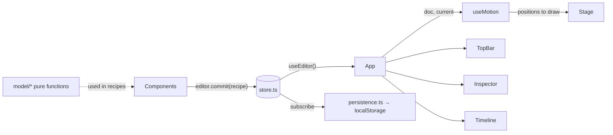

# Unison architecture

This is the complete map of how Unison is built. It must always match the code. **If you change the code, update this file in the same change** (see [AGENTS.md](../AGENTS.md)). If you ever find a mismatch, the code is the source of truth: fix this document.

## 1. What it is and how it runs

Unison is a client-only React app for planning dance formations. There's no server, no account, and no network access at runtime.

- **Build output:** `npm run build` type-checks, then Vite bundles everything into a single self-contained file, `dist/index.html` (all JS and CSS inlined by `vite-plugin-singlefile`, `base: './'`).
- **Running it:** users double-click `dist/index.html`. It runs from `file://` in Edge, Chrome, Safari and Firefox on Windows and macOS. This is the core product requirement; see the [file:// constraints](#9-hard-constraints) below.
- **Development:** `npm run dev` serves the same app with hot reload at `http://localhost:5173`.

### Tech stack

| Piece | Choice | Notes |
| --- | --- | --- |
| Language | TypeScript 7 | `tsc -b` runs before every build. |
| UI | React 19 | Function components and hooks only. |
| Build | Vite 8 + `@vitejs/plugin-react` + `vite-plugin-singlefile` | Configured in `vite.config.ts`. |
| Tests | Vitest 5 | Unit tests for pure model code (Node, no DOM). |
| Lint | Oxlint | Configured in `.oxlintrc.json` (React hooks rules). |
| Rendering | SVG | The stage and thumbnails are plain SVG elements rendered by React. |
| Styling | One global stylesheet | `src/index.css`, dark theme driven by CSS variables. |

Runtime dependencies are only `react` and `react-dom`. Everything else is a dev dependency.

## 2. Repository layout

```text
AGENTS.md                Instructions for AI agents (read first)
README.md                User and developer guide
docs/
  architecture.md        This file
  plan.md                Tech choice rationale, roadmap, open questions
  research-arrangeus.md  Research on ArrangeUs, the app Unison improves on
index.html               HTML shell: title, inline SVG favicon, #root, entry script
vite.config.ts           React plugin + single-file build
package.json             Scripts: dev, build, test, lint, check:private, preview
scripts/
  check-private.mjs      Scans files to be committed for personal or private information (see §10)
.npmrc                   Keeps package-lock.json free of registry URLs (see §10)
.gitattributes           Forces LF line endings on every OS (see §10)
.oxlintrc.json           Lint rules
tsconfig*.json           TypeScript project references (app = src/, node = vite.config.ts)
src/
  main.tsx               Entry: loads autosave or demo, starts autosave, renders <App>
  App.tsx                Layout shell + global keyboard shortcuts
  index.css              All styles
  model/                 Pure data + logic. No React, no DOM, no browser APIs except crypto.getRandomValues
    types.ts             Data types (Choreography, Dancer, Formation, Point, Positions, StageSize)
    stage.ts             Stage geometry: snapping, clamping, offstage test, group drag math
    choreography.ts      Factories (new piece, demo piece) and pure edit functions
    timeline.ts          Playback timing: formation start times, total length, sampling/interpolation
    file.ts              Save-file serialize/parse with validation and repair
    *.test.ts            Vitest unit tests, next to the code they test
  state/                 App state and side effects
    store.ts             Global editor store: document, selection, view options, undo/redo
    persistence.ts       Autosave (localStorage), New/Open/Save
    useMotion.ts         Hook: glide between formations and full playback (requestAnimationFrame)
  components/            React UI
    TopBar.tsx           App name, piece name, undo/redo, New/Open/Save
    Stage.tsx            SVG stage: grid, wings, dancers, ghosts/paths, drag and box select
    Timeline.tsx         Transport (prev/play/next, clock, progress) + formation strip with thumbnails
    Inspector.tsx        Right panel: formation, selected dancers, dancer list, stage and view options, shortcuts
    Icon.tsx             Inline SVG icons (<Icon name=…>) and the logo
    ui.ts                Small UI helpers: shortcut labels, text color on a swatch, clock format, selection toggle
```

## 3. Screen layout

`App` renders a CSS grid (`.app` in `index.css`) with four areas:

```text
┌──────────────────────── TopBar (top) ─────────────────────────┐
│                                               │               │
│  Stage (stage)                                │  Inspector    │
│                                               │  (side, 300px)│
├───────────────────────────────────────────────┤               │
│  Timeline (timeline)                          │               │
└───────────────────────────────────────────────┴───────────────┘
```

## 4. Data model (`src/model/types.ts`)

```ts
Choreography { format: 'unison'; version: 1; name; stage: StageSize; dancers: Dancer[]; formations: Formation[] }
StageSize    { width; depth }                 // meters, performance area only (wings are extra)
Dancer       { id; name; label; color }       // label = 1–3 chars drawn in the marker; color = #rrggbb
Formation    { id; name; positions: Positions; hold; transition; notes }
Positions    = Record<dancerId, Point>
Point        { x; y }
```

### Coordinate system

- Units are **meters**, origin at **center stage**.
- **+x is the audience's right** (which is *stage left*); **+y is downstage**, toward the audience.
- The performance area spans `x ∈ [-width/2, width/2]`, `y ∈ [-depth/2, depth/2]`.
- Offstage **wings** (`WING = 2` m) extend each side, so dancers can be placed at `|x| ≤ width/2 + 2`. A dancer with `|x| > width/2` is offstage and is drawn dimmed. There's no upstage or downstage wing.
- Positions are absolute meters, so resizing the stage doesn't move anyone. Dancers can end up outside a smaller stage; nothing clamps them until they're dragged.

### Invariants

- Every formation has a position for **every** dancer. Adding a dancer adds them to all formations; removing one removes them from all.
- Dancer names, labels and colors are **per piece**, not per formation.
- There's always **at least one** formation.
- Formation `name` may be empty; the UI shows `Formation N` instead (`formationTitle`).
- `hold` = seconds the formation is held; `transition` = seconds spent moving from it into the next. The **last formation's transition is never played**.
- Ids come from `uid()` (16 hex chars from `crypto.getRandomValues`). Don't use `crypto.randomUUID`; some browsers don't expose it on `file://`.

## 5. Model layer (`src/model/`)

All functions are **pure**: they never mutate inputs and return new objects. Edit functions that change nothing should return the **same** object, which lets the store skip creating an undo step.

### `stage.ts`

| Export | Purpose |
| --- | --- |
| `SNAP_STEP = 0.5` | Snap grid in meters (grid lines and midpoints). Also the keyboard nudge step. |
| `WING = 2` | Width of each side wing in meters. |
| `DANCER_RADIUS = 0.32` | Marker radius in meters (used for drawing and for trimming path lines). |
| `clamp`, `snap`, `tidy` | Number helpers. `tidy` rounds to 3 decimals so saved files don't contain float noise. |
| `isOffstage(p, stage)` | `|x| > width/2`. |
| `shift(positions, ids, offset)` | New positions for `ids` moved by `offset` (tidied). |
| `dragOffset(positions, ids, anchor, delta, stage, snapping)` | Offset to apply to a group drag. With snapping, the **grabbed dancer** (`anchor`) lands on the snap grid and the group moves rigidly with it. The group is clamped so nobody leaves the wings horizontally or the stage depth vertically. Also used (without snapping) for keyboard nudges. |

### `choreography.ts`

| Export | Purpose |
| --- | --- |
| `PALETTE` | 12 default dancer colors, assigned round-robin. |
| `uid()` | Random id (see invariants). |
| `formationTitle(f, i)` | Display name with the `Formation N` fallback. |
| `createDancer(i)`, `createFormation(name, positions)` | Factories. New formations default to `hold: 2`, `transition: 1.5`. |
| `lineUp(count, stage)` | Starting positions: centered rows, 2 m apart if they fit across the stage, else 1 m. |
| `createChoreography(n)` | New piece: 12 × 8 m stage, `n` dancers lined up, one formation. |
| `createDemo()` | First-launch sample: 6 named dancers (Ava…Fay), 4 formations (line, V, circle, exit to wings). |
| `setPositions(doc, i, updates)` | Merge position updates into formation `i`. |
| `updateFormation(doc, i, patch)` | Patch `name`, `hold`, `transition`, `notes`. |
| `updateDancers(doc, ids, patch)` | Patch `name`, `label`, `color` on several dancers. |
| `addDancer(doc, i)` | Adds a dancer at the free grid spot nearest center stage (at least 1.5 m from everyone in formation `i`), at that **same spot in every formation**. Returns `{ doc, id }`. |
| `removeDancers(doc, ids)` | Removes dancers and their positions everywhere. |
| `duplicateFormation(doc, i)` | Inserts a copy right after `i` (new id, empty name and notes). This is what "+ Formation" and "Duplicate" do. |
| `removeFormation(doc, i)` | No-op when only one formation is left. |
| `moveFormation(doc, from, to)` | Reorder; no-op when `to` is out of range. |

### `timeline.ts`

Playback time `t` (seconds) runs through each formation as *hold* then *transition*:

```text
| F1 hold | F1→F2 move | F2 hold | F2→F3 move | … | Fn hold |
```

| Export | Purpose |
| --- | --- |
| `ease(t)` | Cosine ease-in-out on `[0, 1]`. |
| `interpolate(from, to, t)` | Per-dancer linear blend (dancers missing from `from` stay at their `to` position). |
| `formationStarts(doc)` | Start time of each formation. |
| `totalDuration(doc)` | Start of the last formation + its hold. |
| `sampleAt(doc, time)` | `{ index, transition, positions }`: the held or departing formation, transition progress (`null` while holding) and eased positions. Clamps to the last formation after the end. |

### `file.ts`

- `serialize(doc)`: pretty-printed JSON of the `Choreography` object, as is.
- `parseChoreography(json)`: throws a readable `Error` for invalid JSON, `format !== 'unison'`, or `version !== 1`. Otherwise it **repairs** rather than rejects: stage sizes are rounded and clamped to 2–60 (default 12 × 8); dancers without a string id or with a duplicate id are dropped, and missing name/label/color are filled in (label truncated to 3 chars); a formation's missing positions come from the previous formation, else from `lineUp`; positions for unknown dancers are dropped; duplicate or missing formation ids get a new `uid()`; invalid `hold`/`transition` fall back to 2 / 1.5; an empty formation list gets one lined-up formation.

## 6. State layer (`src/state/`)

### `store.ts`: the editor store

A single module-level store read in React through `useEditor()` (`useSyncExternalStore`).

```ts
EditorState { doc; current; selection: string[]; view: ViewOptions; past: Snapshot[]; future: Snapshot[] }
ViewOptions { snap; names; prevPaths; nextPaths }
Snapshot    { doc; current }
```

| Method | Behavior |
| --- | --- |
| `init(doc, view)` | Called once in `main.tsx` before rendering. |
| `commit(recipe, coalesce?)` | **The only way to change the document.** Applies `recipe(doc)`; if it returns the same object, nothing happens. Otherwise pushes the previous `{ doc, current }` onto `past` (max 200), clears `future`. Consecutive commits with the same non-undefined `coalesce` key merge into one undo step (used for typing and number fields; keys look like `name:<formationId>`, `nudge:<index>:<ids>`). |
| `undo()` / `redo()` | Restore a snapshot, including which formation was current. Reset coalescing. |
| `setCurrent(i)`, `select(ids)`, `setView(patch)` | Not undoable. |

Every state change clamps `current` to a valid index and, when the document changed, drops selected ids that no longer exist.

### `persistence.ts`

- **Autosave:** `startAutosave()` subscribes to the store and, 400 ms after the last change to `doc` or `view`, writes them to `localStorage` keys `unison.autosave.v1` and `unison.view.v1`. Write errors are ignored.
- **Startup:** `loadAutosave()` parses the saved doc with `parseChoreography` (or returns `null`); `loadView()` merges saved view options over the defaults (`snap`, `names`, `prevPaths` on; `nextPaths` off).
- `canAutosave` probes `localStorage` once; when it's unavailable (some browsers on `file://`), `TopBar` shows a warning.
- **New:** `prompt` for 1–100 dancers → `createChoreography`. **Open:** hidden `<input type=file>` → `parseChoreography`, errors via `alert`. **Save:** downloads `<piece name>.unison.json` through a Blob link (name stripped of characters that are invalid in file names, max 80 chars, fallback `unison`). New and Open replace the piece through `commit`, so **they can be undone**, then reset `current` and the selection.

### `useMotion.ts`: what the stage shows

`useMotion(doc, current)` returns the positions to draw plus transport controls. Internal state is one `Motion` or `null`:

- `glide` (`goTo(i)`): 450 ms eased move from whatever is on screen to formation `i`; also sets `current`.
- `play` (`play()`): starts at the current formation's start time (or at 0 when on the last formation). Each animation frame samples the timeline with `sampleAt`, sets `current` to the sampled index (so the strip and inspector follow along) and stops at the end. It always reads the latest doc from the store.
- `pause()`: stops playback and glides to the nearest formation (the next one if the transition was at least half done).
- `stop()`: drops any motion immediately (used when the user starts editing, or before New/Open).

Returned values: `positions`, `time` (playhead; the current formation's start time when not playing), `total`, `playing`, `moving` (any motion active), and the controls above.

## 7. UI layer

### Data flow



`App` is the only component that calls `useEditor()`; children get state via props and call `editor.*` methods directly to make changes.

### `App.tsx`

Wires the four regions together, defines `addFormation` (duplicate the current formation, then glide to the copy) and handles global keyboard shortcuts with one `keydown` listener on `window` (via `useEffectEvent`):

| Keys | Action | Notes |
| --- | --- | --- |
| Ctrl/⌘+Z, Ctrl/⌘+Shift+Z, Ctrl+Y | Undo / redo | Handled even while typing in a field (replaces the browser's text undo). |
| Ctrl/⌘+S, Ctrl/⌘+O | Save / Open | Also handled while typing. |
| Ctrl/⌘+A | Select all dancers | Ignored while typing (normal text select-all). |
| Space | Play / pause | Ignored when focus is on a button (so Space still clicks it). |
| Esc | Pause and clear selection | |
| Delete / Backspace | Remove selected dancers | |
| Arrows | With a selection: nudge 0.5 m (Shift: 1 m), clamped like a drag and coalesced into one undo step per selection. Without: ←/→ go to previous/next formation. | |

All shortcuts except undo/redo/save/open are ignored while focus is in an `input`, `textarea`, `select` or `contenteditable` element.

### `Stage.tsx`

- Draws in SVG user units with `U = 40` units per meter (large units keep text crisp and above browsers' minimum font sizes). The `viewBox` covers the stage, both wings and margins for labels; the SVG scales to fill its area.
- Layers, back to front: wings with "STAGE RIGHT"/"STAGE LEFT" labels (stage right is on the audience's left), floor, 1 m grid (center lines dashed), floor border, front-edge distance numbers, "UPSTAGE"/"AUDIENCE" labels, ghost guides, dancers, selection marquee.
- **Dancers:** a `<g data-dancer=id>` with selection ring, colored circle, label (text color picked for contrast by `inkFor`, font shrinks for 3-char labels) and optional name. Offstage dancers are dimmed.
- **Guides:** when `prevPaths`/`nextPaths` are on, each dancer gets a dashed ghost circle at their previous/next position and a path line trimmed to the marker edges. Guides are hidden while anything is moving.
- **Pointer gestures** (pointer capture on the SVG; ignored during playback). Any pointer down first calls `onEditStart` (stops glides). Then:
  - Shift/Ctrl/⌘+click a dancer toggles it in the selection.
  - Pressing a dancer starts a **drag** of the selection (or just that dancer if it isn't selected). While dragging, positions are previewed locally with `dragOffset`; on release the move is committed once (if it moved more than 0.05 m).
  - Pressing empty space starts a **box select** (added to the current selection when a modifier key is held); dancers inside the box (using the positions on screen) are selected live.
  - The current gesture is kept in both a ref (read by handlers, always fresh) and state (for rendering).

### `Timeline.tsx`

Transport row (previous, play/pause, next, `m:ss.s` clock, progress bar) and a horizontally scrolling strip of formation cards. Each card shows a memoized SVG `Thumbnail`, number, title and timing; the current card scrolls into view. The last item is the "+ Formation" card.

### `Inspector.tsx`

Sections, top to bottom:

1. **Formation** (re-mounted per formation via `key` so number drafts reset): name, hold, move-to-next, notes, move earlier/later, Duplicate, Delete.
2. **Selected dancer(s)** (only with a selection): name and label (single selection only), palette swatches and a custom color input, remove.
3. **Dancers** list (click to select, modifier-click to toggle) and **Add dancer** (adds near center of the current formation and selects them).
4. **Stage & view:** width/depth (2–60 m, whole meters) and the four view toggles.
5. **Keyboard shortcuts** (collapsible).

`NumberField` keeps the raw text while typing so a field can be cleared and retyped; it only commits valid, clamped numbers. Text and number edits use coalesce keys so each field edit is one undo step.

### `TopBar.tsx`, `Icon.tsx`, `ui.ts`

- `TopBar`: logo and name, editable piece name, autosave warning when needed, undo/redo, New, Open…, Save. Calls `onBeforeReplace` (stop motion) before New/Open.
- `Icon`: inline SVG paths (`play`, `pause`, `prev`, `next`, `plus`, `undo`, `redo`, `left`, `right`) rendered with class `glyph`; `Logo` for the brand mark.
- `ui.ts`: `shortcut('Mod+Z')` → `⌘Z` on Apple devices or `Ctrl+Z` elsewhere; `inkFor(color)`; `clock(seconds)`; `toggleId(ids, id)`.

### Styling (`index.css`)

Single dark theme defined by CSS variables on `:root` (`--bg`, `--panel`, `--accent`, `--floor`, …). Classes are plain and global (`.btn`, `.btn.icon`, `.btn.primary`, `.card`, `.field`, …). Button-size class `.btn.icon` and the SVG glyph class `.glyph` are deliberately different names. There's no CSS-in-JS or CSS modules.

## 8. Save-file format

A saved piece (`*.unison.json`) is `serialize(doc)`:

```json
{
  "format": "unison",
  "version": 1,
  "name": "Demo piece",
  "stage": { "width": 12, "depth": 8 },
  "dancers": [{ "id": "3f9c…", "name": "Ava", "label": "A", "color": "#f87171" }],
  "formations": [
    { "id": "a1b2…", "name": "Opening line", "positions": { "3f9c…": { "x": -5, "y": 0 } }, "hold": 2, "transition": 1.5, "notes": "" }
  ]
}
```

The same JSON is stored in `localStorage` for autosave. **Any change to this shape must bump `version`** and teach `parseChoreography` to read (migrate) older versions, so existing files and autosaves keep opening.

## 9. Hard constraints

These keep the "double-click one file, any OS" promise. Breaking one usually works in `npm run dev` but fails in the built file.

- **Must work from `file://`:** don't fetch local files, add service workers, or rely on code splitting/lazy-loaded chunks. Imported assets must be inlined by the single-file build. No `crypto.randomUUID` (use `uid()`).
- **Storage may be unavailable:** always go through `persistence.ts`, which tolerates `localStorage` failures.
- **Cross-browser file I/O:** Save is a Blob download and Open is an `<input type=file>`. Don't depend on the File System Access API (not in Safari or Firefox).
- **No runtime network access or accounts.**
- **Platform-neutral input:** Ctrl and ⌘ are treated the same; show shortcuts with `shortcut()`.

## 10. Conventions

- **Changes to the piece go through `editor.commit`** with a pure recipe built from model functions. Never mutate the doc.
- **Model code stays pure** and framework-free; put logic there when it can be unit tested.
- **Imports use explicit extensions** (`./store.ts`, `./Stage.tsx`), and type-only imports use `import type` (`verbatimModuleSyntax`). `erasableSyntaxOnly` is on, so no `enum`, `namespace` or constructor parameter properties.
- **Formatting:** no semicolons, single quotes, 2-space indent, compact one-line calls where readable.
- **Comments** only where something is non-obvious; short JSDoc on exports explains behavior, not parameters.
- **Tests:** Vitest files next to the code (`*.test.ts`), focused on behavior of the model layer.
- **Line endings:** LF everywhere, enforced by `.gitattributes` (`* text=auto eol=lf`). Keep new files LF.
- **Lockfile:** `.npmrc` sets `omit-lockfile-registry-resolved=true`, so `package-lock.json` never records registry URLs (for example a company mirror). Keep it that way.
- **No personal or employer information, ever** (the full rule is at the top of [AGENTS.md](../AGENTS.md)): no names, usernames, emails, machine paths, internal URLs or credentials anywhere in the repo. `scripts/check-private.mjs` (`npm run check:private`) enforces what it can: it reads `git ls-files --cached --others --exclude-standard` (or the files passed as arguments), skips binary files and itself, and fails on email addresses, local paths, credential patterns, `"resolved"` URLs in `package-lock.json`, and link hosts missing from its `ALLOWED_HOSTS` list (lockfile links are exempt because they're npm package metadata). Names and employer details in prose can only be caught by reading the changes.

## 11. Testing and verification

| Command | What it checks |
| --- | --- |
| `npm test` | Unit tests: timeline sampling, drag snapping/clamping, file round-trip/repair/rejection, formation and dancer edits. |
| `npm run lint` | Oxlint. |
| `npm run check:private` | No personal or private information in files that would be committed (see §10). Required before finishing any change. |
| `npm run build` | Type-check (`tsc -b`) + single-file build. |

There's no automated UI test suite yet. UI changes should be checked by opening the built `dist/index.html` directly (not just the dev server), because the `file://` constraints only show up there.

## 12. Not implemented yet

The prototype intentionally leaves out (see [plan.md](plan.md) for the roadmap): a multi-piece library, dancer shapes and per-formation colors, music and count-based timing, curved paths, position tools (align, mirror, rotate…), formation presets, drag-reordering in the strip, props, backgrounds, export (PDF/PNG/video), 3D, and collaboration. Stage numbers and units are meters only.
