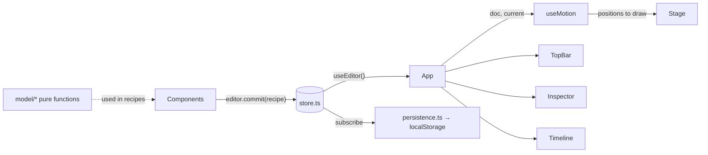

# Unison architecture

This is the complete map of how Unison is built. It must always match the code. **If you change the code, update this file in the same change** (see [AGENTS.md](../AGENTS.md)). If you ever find a mismatch, the code is the source of truth: fix this document.

## 1. What it is and how it runs

Unison is a client-only React app for planning dance formations. There's no server, no account, and no network access at runtime.

- **Build output:** `npm run build` type-checks, then Vite bundles everything into a single self-contained file, `dist/index.html` (all JS and CSS inlined by `vite-plugin-singlefile`, `base: './'`).
- **Running it:** users double-click `dist/index.html`. It runs from `file://` in Edge, Chrome, Safari and Firefox on Windows and macOS. This is the core product requirement; see the [file:// constraints](#9-hard-constraints) below.
- **Development:** `npm run dev` serves the same app with hot reload at `http://localhost:5173`.

### Tech stack

| Piece | Choice | Notes |
| --- | --- | --- |
| Language | TypeScript 7 | `tsc -b` runs before every build. |
| UI | React 19 | Function components and hooks only. |
| Build | Vite 8 + `@vitejs/plugin-react` + `vite-plugin-singlefile` | Configured in `vite.config.ts`. |
| Tests | Vitest 5 | Unit tests for model and store code (Node, no DOM). |
| Lint | Oxlint | Configured in `.oxlintrc.json` (React hooks rules). |
| Rendering | SVG | The stage and thumbnails are plain SVG elements rendered by React. |
| Styling | One global stylesheet | `src/index.css`, dark theme driven by CSS variables. |

Runtime dependencies are only `react` and `react-dom`. Everything else is a dev dependency.

## 2. Repository layout

```text
AGENTS.md                Instructions for AI agents (read first)
README.md                User and developer guide
docs/
  architecture.md        This file
  plan.md                Tech choice rationale, roadmap, open questions
  research-arrangeus.md  Research on ArrangeUs, the app Unison improves on
index.html               HTML shell: title, inline SVG favicon, #root, entry script
vite.config.ts           React plugin + single-file build
package.json             Scripts: dev, build, test, lint, check:private, preview
scripts/
  check-private.mjs      Scans files to be committed for personal or private information (see §10)
.npmrc                   Keeps package-lock.json free of registry URLs (see §10)
.gitattributes           Forces LF line endings on every OS (see §10)
.gitignore               Ignores node_modules/, dist/ and .projects/
.projects/               Local folder for your own .unison project files; git-ignored, never committed
.oxlintrc.json           Lint rules
tsconfig*.json           TypeScript project references (app = src/, node = vite.config.ts)
src/
  main.tsx               Entry: restores the autosaved project (if any), starts autosave, restores the file link and recent list, renders <App>
  App.tsx                Shows Welcome or the Editor (layout shell + global keyboard shortcuts)
  index.css              All styles
  model/                 Pure data + logic. No React, no DOM, no browser APIs except crypto.getRandomValues
    types.ts             Data types (Choreography, Dancer, Formation, Point, Positions, StageSize)
    stage.ts             Stage geometry: snapping, clamping, offstage test, group drag math
    choreography.ts      Factories (new project, sample project for tests) and pure edit functions
    interpolate.ts       Glide math: easing and blending positions between two formations
    file.ts              Save-file serialize/parse with validation and repair
    *.test.ts            Vitest unit tests, next to the code they test
  state/                 App state and side effects
    store.ts             Global editor store: open project (or none), selection, view options, undo/redo
    persistence.ts       Autosave (localStorage), New/Open/Save/Save as of .unison project files, unsaved-changes guard
    fileHandles.ts       Save in place (Edge/Chrome): file pickers, permissions, writing, linked file + recent list in IndexedDB
    useMotion.ts         Hook: short glide between formations (requestAnimationFrame)
    store.test.ts        Vitest unit tests for the store (no project open, fresh history on open, unsaved-changes tracking, close)
  components/            React UI
    Welcome.tsx          Start screen while no project is open: New project / Open project… / recent projects
    TopBar.tsx           App name, project name, save status, undo/redo, New/Open/Save as/Save
    OpenMenu.tsx         Top-bar "Open ▾" dropdown (Open a file… + recent projects), used once there are recent projects
    RecentList.tsx       List of recent projects (one click to reopen, × to remove), shared by Welcome and OpenMenu
    Stage.tsx            SVG stage: grid, wings, dancers, ghosts/paths, drag and box select
    Timeline.tsx         Formation navigation (prev/next, "Formation N of M") + formation strip with thumbnails
    Inspector.tsx        Right panel: formation, selected dancers, dancer list, stage and view options, shortcuts
    Icon.tsx             Inline SVG icons (<Icon name=…>) and the logo
    ui.ts                Small UI helpers: shortcut labels, text color on a swatch, selection toggle
```

## 3. Screen layout

With **no project open**, `App` renders only the `Welcome` screen: a centered card with **New project** and **Open project…**. There's no demo or sample project at startup.

With a project open, `App` renders the editor as a CSS grid (`.app` in `index.css`) with four areas:

```text
┌──────────────────────── TopBar (top) ─────────────────────────┐
│                                               │               │
│  Stage (stage)                                │  Inspector    │
│                                               │  (side, 300px)│
├───────────────────────────────────────────────┤               │
│  Timeline (timeline)                          │               │
└───────────────────────────────────────────────┴───────────────┘
```

## 4. Data model (`src/model/types.ts`)

```ts
Choreography { format: 'unison'; version: 2; name; stage: StageSize; dancers: Dancer[]; formations: Formation[] }
StageSize    { width; depth; grid }           // feet; width/depth = performance area only (wings are extra); grid = side of each grid square
Dancer       { id; name; label; color }       // label = 1–3 chars drawn in the marker; color = #rrggbb
Formation    { id; name; positions: Positions; notes }
Positions    = Record<dancerId, Point>
Point        { x; y }
```

### Coordinate system

- Units are **feet**, origin at **center stage**. (Files before version 2 used meters and are converted when opened.)
- **+x is the audience's right** (which is *stage left*); **+y is downstage**, toward the audience.
- The performance area spans `x ∈ [-width/2, width/2]`, `y ∈ [-depth/2, depth/2]`.
- Offstage **wings** (`WING = 6` ft) extend each side, so dancers can be placed at `|x| ≤ width/2 + 6`. A dancer with `|x| > width/2` is offstage and is drawn dimmed. There's no upstage or downstage wing.
- Positions are absolute feet, so resizing the stage doesn't move anyone. Dancers can end up outside a smaller stage; nothing clamps them until they're dragged.

### Invariants

- Every formation has a position for **every** dancer. Adding a dancer adds them to all formations; removing one removes them from all.
- Dancer names, labels and colors are **per piece**, not per formation.
- There's always **at least one** formation.
- Formation `name` may be empty; the UI shows `Formation N` instead (`formationTitle`).
- **No time.** A piece is just an ordered list of formations; there are no hold durations, transition durations, playback or music (yet). Older files that stored `hold`/`transition` still open; the fields are dropped.
- Ids come from `uid()` (16 hex chars from `crypto.getRandomValues`). Don't use `crypto.randomUUID`; some browsers don't expose it on `file://`.

## 5. Model layer (`src/model/`)

All functions are **pure**: they never mutate inputs and return new objects. Edit functions that change nothing should return the **same** object, which lets the store skip creating an undo step.

### `stage.ts`

| Export | Purpose |
| --- | --- |
| `snapStep(stage)` | Half a grid square (`stage.grid / 2`): dancers snap to grid lines and square centers. Also the keyboard nudge step (Shift+arrow nudges a whole square). |
| `gridSize(feet)` | Rounds a square size to the nearest half foot within `MIN_GRID`–`MAX_GRID` (1–20 ft). |
| `WING = 6` | Width of each side wing in feet. |
| `DANCER_RADIUS = 1` | Marker radius in feet (used for drawing and for trimming path lines). |
| `DEFAULT_STAGE`, `MIN_STAGE`, `MAX_STAGE` | New-project stage (40 × 24 ft with 2 ft squares) and the allowed width/depth range (6–200 ft). |
| `FEET_PER_METER` | Converts version 1 (meter) files when they're opened. |
| `gridLines(half, step)` | Positions every `step` feet from center outward within `±half` (used for grid lines and `addDancer`'s candidate spots, with `step = stage.grid`). |
| `clamp`, `snap`, `tidy` | Number helpers. `tidy` rounds to 3 decimals so saved files don't contain float noise. |
| `isOffstage(p, stage)` | `|x| > width/2`. |
| `shift(positions, ids, offset)` | New positions for `ids` moved by `offset` (tidied). |
| `dragOffset(positions, ids, anchor, delta, stage, snapping)` | Offset to apply to a group drag. With snapping, the **grabbed dancer** (`anchor`) lands on the snap grid and the group moves rigidly with it. The group is clamped so nobody leaves the wings horizontally or the stage depth vertically. Also used (without snapping) for keyboard nudges. |

### `choreography.ts`

| Export | Purpose |
| --- | --- |
| `PALETTE` | 12 default dancer colors, assigned round-robin. |
| `uid()` | Random id (see invariants). |
| `formationTitle(f, i)` | Display name with the `Formation N` fallback. |
| `createDancer(i)`, `createFormation(name, positions)` | Factories. |
| `lineUp(count, stage)` | Starting positions: centered rows, 6 ft or 4 ft apart (whichever fits across the stage first), else 2 ft apart in several rows. Spacings are even so everyone lands on whole feet (on the snap grid for the default 2 ft squares). |
| `createChoreography(n)` | New project: 40 × 24 ft stage, `n` dancers lined up, one formation. |
| `createDemo()` | Sample project (6 named dancers Ava…Fay, 4 formations: line, V, circle, exit to wings). Used by unit tests; the app never loads it. |
| `setPositions(doc, i, updates)` | Merge position updates into formation `i`. |
| `updateFormation(doc, i, patch)` | Patch `name`, `notes`. |
| `updateDancers(doc, ids, patch)` | Patch `name`, `label`, `color` on several dancers. |
| `addDancer(doc, i)` | Adds a dancer at the free grid-line intersection nearest center stage (at least 4 ft from everyone in formation `i`), at that **same spot in every formation**. Returns `{ doc, id }`. |
| `removeDancers(doc, ids)` | Removes dancers and their positions everywhere. |
| `duplicateFormation(doc, i)` | Inserts a copy right after `i` (new id, empty name and notes). This is what "+ Formation" and "Duplicate" do. |
| `removeFormation(doc, i)` | No-op when only one formation is left. |
| `moveFormation(doc, from, to)` | Reorder; no-op when `to` is out of range. |

### `interpolate.ts`

Used only for the short glide between formations. There's deliberately **no concept of time** in the model: formations are an ordered list of snapshots with no hold or transition durations.

| Export | Purpose |
| --- | --- |
| `ease(t)` | Cosine ease-in-out on `[0, 1]`. |
| `interpolate(from, to, t)` | Per-dancer linear blend (dancers missing from `from` stay at their `to` position). |

### `file.ts`

- `serialize(doc)`: pretty-printed JSON of the `Choreography` object, as is.
- `parseChoreography(json)`: throws a readable `Error` for invalid JSON, `format !== 'unison'`, or a `version` other than 1 or 2. **Version 1 files were in meters**: their stage size and positions are multiplied by `FEET_PER_METER` (positions tidied to 3 decimals, stage sizes rounded to whole feet), and the result is version 2. Otherwise it **repairs** rather than rejects: stage sizes are rounded and clamped to 6–200 ft (default 40 × 24); the grid square size goes through `gridSize` (default 2 ft when missing, e.g. in files from before the setting existed or version 1 files); dancers without a string id or with a duplicate id are dropped, and missing name/label/color are filled in (label truncated to 3 chars); a formation's missing positions come from the previous formation, else from `lineUp`; positions for unknown dancers are dropped; duplicate or missing formation ids get a new `uid()`; `hold`/`transition` fields from older files (and any other unknown fields) are dropped; an empty formation list gets one lined-up formation.

## 6. State layer (`src/state/`)

### `store.ts`: the editor store

A single module-level store read in React through `useEditor()` (`useSyncExternalStore`).

```ts
EditorState   { doc: Choreography | null; savedDoc: Choreography | null; fileName: string | null; recent: RecentProject[]; current; selection: string[]; view: ViewOptions; past: Snapshot[]; future: Snapshot[] }
RecentProject { handle: FileSystemFileHandle; projectName }   // project name as of the last open/save of that file
OpenState   = EditorState & { doc: Choreography }   // narrowed with isOpen(state)
ViewOptions { snap; names; prevPaths; nextPaths }
Snapshot    { doc; current }
```

`doc` is `null` until the first project is created or opened (or restored from autosave), and again after the project is closed (clicking the logo).

**Unsaved changes:** `savedDoc` is the document as last opened from or saved to a file (`null` if it never was). `hasUnsavedChanges(state)` is simply `doc !== savedDoc`. Because documents are immutable, undoing back to the saved version makes the project "saved" again. `fileName` is the name of the linked file Save writes to (Edge/Chrome only; `null` otherwise). `recent` is the recent-projects list (Edge/Chrome only; always empty elsewhere). None of these are part of undo history.

| Method | Behavior |
| --- | --- |
| `init(doc, view, savedDoc?)` | Called once in `main.tsx` before rendering, with the autosaved project (or `null`) and, if it had no unsaved changes, the same doc as `savedDoc`. |
| `commit(recipe, coalesce?)` | **The only way to change the document.** No-op when no project is open. Applies `recipe(doc)`; if it returns the same object, nothing happens. Otherwise pushes the previous `{ doc, current }` onto `past` (max 200), clears `future`. Consecutive commits with the same non-undefined `coalesce` key merge into one undo step (used for typing and number fields; keys look like `name:<formationId>`, `nudge:<index>:<ids>`). |
| `open(doc, fileName, saved)` | Shows `doc` as the open project with a **fresh undo history**, resets `current` and the selection, and sets `fileName` and `savedDoc` (`doc` if `saved`, else `null`). Opening is deliberately not undoable: otherwise undo could bring back a different project while Save still points at the newly opened file and overwrite it. Unsaved work is protected by a confirmation in `persistence.ts` instead. |
| `markSaved(doc, fileName)` | Records that `doc` (the version that was written, which may be older than the current doc if the user kept editing during the write) is saved, and the linked file name. |
| `setFileName(name)` | Used when the remembered file link is restored after startup. |
| `setRecent(list)` | Replaces the recent-projects list (only `persistence.ts` calls it). |
| `close()` | Closes the project: `doc`, `savedDoc` and `fileName` become `null` and history is cleared, so `App` shows the welcome screen. |
| `undo()` / `redo()` | Restore a snapshot, including which formation was current. Reset coalescing. |
| `setCurrent(i)`, `select(ids)`, `setView(patch)` | Not undoable. |

While a project is open, every state change clamps `current` to a valid index and, when the document changed, drops selected ids that no longer exist.

### `persistence.ts`

- **Project files:** a project is saved as `<project name>.unison` (`FILE_EXTENSION`), containing `serialize(doc)` JSON (see §8). The file name is the project name stripped of characters that are invalid in file names, max 80 chars, fallback `Untitled`.
- **Two ways of saving**, chosen by `supportsFileHandles` (from `fileHandles.ts`):
  - **Edge and Chrome (save in place):** Open uses the browser's file picker and keeps the file's handle as the **linked file** (module variable `linkedFile`; the store only holds its name). **Save** writes straight back to the linked file. **Save as…** asks for a new location (suggested name `<project name>.unison`, same remembered folder as Open), writes there, and makes it the linked file. Save without a linked file (a new project) behaves like Save as. If the linked file was moved or deleted, Save falls back to Save as; if the user refuses write permission, an alert explains it and suggests Save as.
  - **Safari and Firefox (no file access API):** Open uses a hidden `<input type=file accept=".unison">`; Save downloads `<project name>.unison` through a Blob link (type `application/octet-stream`, so browsers keep the exact name instead of appending `.json`). There's no Save as… button; nothing is ever linked.
- **Remembering the linked file:** whenever the linked file changes, its handle is stored in IndexedDB (`rememberFile`; `null` deletes it). On startup, `restoreFileLink()` (called from `main.tsx`) re-links it if a project was restored, so Save keeps writing to the same file after the browser is reopened. The browser asks for write permission again on the first Save of a new session. A `generation` counter, bumped whenever the project is replaced, stops slow async work (restoring the link, writing a file) from applying to a project that was replaced in the meantime.
- **New / Open** go through `replaceProject`, which updates `linkedFile` (null for New and for fallback Open) and calls `editor.open`. Both first call `okToReplace()`: if the project has unsaved changes, a `confirm` asks before discarding them. New prompts for 1–100 dancers → `createChoreography` (not saved: `savedDoc` is null). Open errors are shown with `alert`.
- **Close** (`closeProject()`, the top-bar logo): also asks via `okToReplace()`, then unlinks the file (and forgets it in IndexedDB) and calls `editor.close()`. Autosave then removes the saved project from `localStorage`, so reopening the page shows the welcome screen too.
- **Recent projects (Edge and Chrome):** opening a file, Save and Save as each call `addRecent(file, projectName)`, which moves that file to the top of the list (deduplicated with `isSameEntry`, max 8) and stores the list in IndexedDB. `loadRecent()` (from `main.tsx`) loads it at startup. `openRecent(entry)` reopens a project **without a file window**: after `okToReplace()`, it asks for read-write permission (no prompt within a session where it's already granted; one browser prompt after a restart, which also covers later saves), reads and parses the file, and links it. If the file was moved or deleted, an `alert` says so and the entry is dropped. `forgetRecent(entry)` removes one entry. The reason for this feature: the Windows file dialog itself takes about 1 s to open and another ~0.9 s to close (measured the same for the file-access picker and a plain file input), so skipping it is the only way to make reopening fast.
- **Autosave:** `startAutosave()` subscribes to the store and, 400 ms after the last change to `doc`, `savedDoc` or `view`, writes `localStorage` keys `unison.autosave.v1` (the project, only when one is open), `unison.unsaved.v1` (`'0'` if it matches its file, `'1'` if not) and `unison.view.v1`. When no project is open, it removes the first two keys instead. Write errors are ignored.
- **Startup:** `loadAutosave()` returns the saved project and whether it had unsaved changes (missing flag counts as unsaved), or `null` (nothing saved, or unreadable), in which case the welcome screen shows. So whatever project was open last time comes back when the page is reopened, still marked saved or unsaved. `loadView()` merges saved view options over the defaults (`snap`, `names`, `prevPaths` on; `nextPaths` off).
- `canAutosave` probes `localStorage` once; when it's unavailable (some browsers on `file://`), `Welcome` and `TopBar` show a warning.

### `fileHandles.ts`: save-in-place helpers

Thin wrapper over the File System Access API (`showOpenFilePicker`, `showSaveFilePicker`, `createWritable`, `queryPermission`/`requestPermission`), which only Chromium browsers (Edge, Chrome) have. It works on `file://` pages there. The API isn't in TypeScript's DOM types, so the needed shapes are declared locally.

| Export | Purpose |
| --- | --- |
| `supportsFileHandles` | Both pickers exist. Everything else is only called when this is true. |
| `pickFileToOpen(ext)`, `pickFileToSave(ext, suggestedName)` | Pickers filtered to `.unison`, sharing picker id `unison-projects` so the browser remembers the last folder. Return `null` when the user cancels. |
| `ensurePermission(handle, mode)` | Checks `'read'` or `'readwrite'` permission and asks the user if needed; returns `false` if refused. |
| `writeFile(handle, text)` | `ensurePermission(handle, 'readwrite')`, then overwrites the file. Returns `false` if permission was refused. |
| `rememberFile(handle \| null)`, `recallFile()` | Store/load the linked file handle in IndexedDB (database `unison`, store `files`, key `current`). Failures are swallowed; the only effect is that Save asks where to save. |
| `saveRecentProjects(list)`, `loadRecentProjects()` | Store/load the recent-projects list (same store, key `recent`). Failures are swallowed; the list just won't survive a restart. |

### `useMotion.ts`: what the stage shows

`useMotion(doc, current)` returns the positions to draw. Internal state is one `Glide` or `null`:

- `goTo(i)`: sets `current` to formation `i` and starts a 450 ms eased glide (`requestAnimationFrame`) from whatever is on screen (even mid-glide) to that formation. This is a fixed-speed preview, not a timing setting.
- `stop()`: drops any glide immediately (used when the user starts editing, or before New/Open).

Returned values: `positions`, `moving` (a glide is running), `goTo`, `stop`.

## 7. UI layer

### Data flow



`App` is the only component that calls `useEditor()`. It renders `Welcome` when `isOpen(state)` is false, otherwise the internal `Editor` component with an `OpenState`. Editor children get state via props and call `editor.*` methods directly to make changes; `useMotion` lives in `Editor`, so it only runs while a project is open (it still guards against a missing doc).

### `App.tsx`

`Editor` wires the four regions together, defines `addFormation` (duplicate the current formation, then glide to the copy) and handles global keyboard shortcuts with one `keydown` listener on `window` (via `useEffectEvent`). The welcome screen has no keyboard shortcuts.

| Keys | Action | Notes |
| --- | --- | --- |
| Ctrl/⌘+Z, Ctrl/⌘+Shift+Z, Ctrl+Y | Undo / redo | Handled even while typing in a field (replaces the browser's text undo). |
| Ctrl/⌘+S, Ctrl/⌘+Shift+S, Ctrl/⌘+O | Save / Save as / Open | Also handled while typing. |
| Ctrl/⌘+A | Select all dancers | Ignored while typing (normal text select-all). |
| Esc | Clear selection | |
| Delete / Backspace | Remove selected dancers | |
| Arrows | With a selection: nudge half a grid square (Shift: a whole square), clamped like a drag and coalesced into one undo step per selection. Without: ←/→ go to previous/next formation. | |

All shortcuts except undo/redo/save/open are ignored while focus is in an `input`, `textarea`, `select` or `contenteditable` element.

### `Stage.tsx`

- Draws in SVG user units with `U = 12` units per foot (large enough units keep text crisp and above browsers' minimum font sizes). The `viewBox` covers the stage, both wings and margins for labels; the SVG scales to fill its area. Label margins and offsets are fixed SVG units, not feet, so labels look the same on any stage size.
- Layers, back to front: wings with "STAGE RIGHT"/"STAGE LEFT" labels (stage right is on the audience's left), floor, grid lines every `stage.grid` feet (`gridLines`, center lines dashed), floor border, front-edge stage numbers (distance from center) on every grid line, or on every 2nd/3rd… line when squares are under 2 ft so numbers never sit closer than 2 ft apart, "UPSTAGE"/"AUDIENCE" labels, ghost guides, dancers, selection marquee.
- **Dancers:** a `<g data-dancer=id>` with selection ring, colored circle, label (text color picked for contrast by `inkFor`, font shrinks for 3-char labels) and optional name. Offstage dancers are dimmed.
- **Guides:** when `prevPaths`/`nextPaths` are on, each dancer gets a dashed ghost circle at their previous/next position and a path line trimmed to the marker edges. Guides are hidden while anything is moving.
- **Pointer gestures** (pointer capture on the SVG). Any pointer down first calls `onEditStart` (stops glides). Then:
  - Shift/Ctrl/⌘+click a dancer toggles it in the selection.
  - Pressing a dancer starts a **drag** of the selection (or just that dancer if it isn't selected). While dragging, positions are previewed locally with `dragOffset`; on release the move is committed once (if it moved more than 0.15 ft).
  - Pressing empty space starts a **box select** (added to the current selection when a modifier key is held); dancers inside the box (using the positions on screen) are selected live.
  - The current gesture is kept in both a ref (read by handlers, always fresh) and state (for rendering).

### `Timeline.tsx`

Navigation row (previous and next formation buttons, "Formation N of M") and a horizontally scrolling strip of formation cards. Each card shows a memoized SVG `Thumbnail`, number, title and a "Has notes" marker; the current card scrolls into view. The last item is the "+ Formation" card.

### `Inspector.tsx`

Sections, top to bottom:

1. **Formation:** name, notes, move earlier/later, Duplicate, Delete.
2. **Selected dancer(s)** (only with a selection): name and label (single selection only), palette swatches and a custom color input, remove.
3. **Dancers** list (click to select, modifier-click to toggle) and **Add dancer** (adds near center of the current formation and selects them).
4. **Stage & view:** width/depth (6–200 ft, whole feet), **grid square size** (1–20 ft in half-foot steps, rounded by `gridSize`; one coalesced undo step per edit), and the four view toggles. The shortcut list shows the current nudge sizes.
5. **Keyboard shortcuts** (collapsible).

`NumberField` keeps the raw text while typing so a field can be cleared and retyped; it only commits valid, clamped numbers. Text and number edits use coalesce keys so each field edit is one undo step.

### `TopBar.tsx`, `OpenMenu.tsx`, `RecentList.tsx`, `Welcome.tsx`, `Icon.tsx`, `ui.ts`

- `Welcome`: logo, one-line description, **New project** and **Open project…** (same `newPiece`/`openPiece` as the top bar), the **Recent projects** list when there is one (`App` passes `state.recent`), a note that projects save as `.unison` files and the open project is restored next time, and the autosave warning when needed.
- `TopBar`: logo and name (a button: closes the project and returns to the welcome screen via `closeProject`), editable project name, save status (`● Unsaved changes` in amber, otherwise `Saved to <file>` when a file is linked, else `Saved`), autosave warning when needed, undo/redo, New, Open (a plain **Open…** button, or the `OpenMenu` dropdown once there are recent projects), Save as… (only when `supportsFileHandles`), Save (tooltip names the linked file). Calls `onBeforeReplace` (stop motion) before New/Open.
- `OpenMenu`: **Open ▾** button with a dropdown containing "Open a file…" (with its Ctrl/⌘+O hint) and the `RecentList`. Closes on choosing an item, clicking outside, or Esc.
- `RecentList`: one row per recent project (project name, file name underneath); clicking a row calls `openRecent`, the faded **×** calls `forgetRecent`. It stays visible (not hover-only) so it works on touch screens too.
- `Icon`: inline SVG paths (`prev`, `next`, `plus`, `undo`, `redo`, `left`, `right`, `down`) rendered with class `glyph`; `Logo` for the brand mark.
- `ui.ts`: `shortcut('Mod+Z')` → `⌘Z` on Apple devices or `Ctrl+Z` elsewhere; `inkFor(color)`; `toggleId(ids, id)`.

### Styling (`index.css`)

Single dark theme defined by CSS variables on `:root` (`--bg`, `--panel`, `--accent`, `--floor`, …). Classes are plain and global (`.btn`, `.btn.icon`, `.btn.primary`, `.card`, `.field`, …). Button-size class `.btn.icon` and the SVG glyph class `.glyph` are deliberately different names. There's no CSS-in-JS or CSS modules.

## 8. Project file format

A project file (`<name>.unison`) contains `serialize(doc)`, which is plain JSON:

```json
{
  "format": "unison",
  "version": 2,
  "name": "Spring show",
  "stage": { "width": 40, "depth": 24, "grid": 2 },
  "dancers": [{ "id": "3f9c…", "name": "Ava", "label": "A", "color": "#f87171" }],
  "formations": [
    { "id": "a1b2…", "name": "Opening line", "positions": { "3f9c…": { "x": -15, "y": 0 } }, "notes": "" }
  ]
}
```

All lengths are feet. Version history: **1** = meters (converted on open); **2** = feet (current). `stage.grid` was added within version 2 without a bump: files without it simply get the 2 ft default they were already using.

The file extension is `.unison`, but `parseChoreography` only looks at the content (`format` and `version`), not the file name. The same JSON is stored in `localStorage` for autosave. **Any change that this parser couldn't read correctly from an older file (new required fields, renamed fields, changed meaning) must bump `version`** and teach `parseChoreography` to migrate older versions, so existing files and autosaves keep opening. Removing a field that the parser simply ignores in older files (as with the old `hold`/`transition` times) doesn't need a bump.

## 9. Hard constraints

These keep the "double-click one file, any OS" promise. Breaking one usually works in `npm run dev` but fails in the built file.

- **Must work from `file://`:** don't fetch local files, add service workers, or rely on code splitting/lazy-loaded chunks. Imported assets must be inlined by the single-file build. No `crypto.randomUUID` (use `uid()`).
- **Storage may be unavailable:** always go through `persistence.ts`, which tolerates `localStorage` failures.
- **Cross-browser file I/O:** every file feature must work in Safari and Firefox too. The File System Access API (save in place) is only used behind `supportsFileHandles`, with the download / `<input type=file>` fallback for other browsers.
- **No runtime network access or accounts.**
- **Platform-neutral input:** Ctrl and ⌘ are treated the same; show shortcuts with `shortcut()`.

## 10. Conventions

- **Changes to the piece go through `editor.commit`** with a pure recipe built from model functions. Never mutate the doc.
- **Model code stays pure** and framework-free; put logic there when it can be unit tested.
- **Imports use explicit extensions** (`./store.ts`, `./Stage.tsx`), and type-only imports use `import type` (`verbatimModuleSyntax`). `erasableSyntaxOnly` is on, so no `enum`, `namespace` or constructor parameter properties.
- **Formatting:** no semicolons, single quotes, 2-space indent, compact one-line calls where readable.
- **Comments** only where something is non-obvious; short JSDoc on exports explains behavior, not parameters.
- **Tests:** Vitest files next to the code (`*.test.ts`), focused on behavior of the model layer and the store.
- **Line endings:** LF everywhere, enforced by `.gitattributes` (`* text=auto eol=lf`). Keep new files LF.
- **Lockfile:** `.npmrc` sets `omit-lockfile-registry-resolved=true`, so `package-lock.json` never records registry URLs (for example a company mirror). Keep it that way.
- **No personal or employer information, ever** (the full rule is at the top of [AGENTS.md](../AGENTS.md)): no names, usernames, emails, machine paths, internal URLs or credentials anywhere in the repo. `scripts/check-private.mjs` (`npm run check:private`) enforces what it can: it reads `git ls-files --cached --others --exclude-standard` (or the files passed as arguments), skips binary files and itself, and fails on email addresses, local paths, credential patterns, `"resolved"` URLs in `package-lock.json`, and link hosts missing from its `ALLOWED_HOSTS` list (lockfile links are exempt because they're npm package metadata). Names and employer details in prose can only be caught by reading the changes.

## 11. Testing and verification

| Command | What it checks |
| --- | --- |
| `npm test` | Unit tests: glide interpolation, drag snapping/clamping, file round-trip/repair/rejection (including dropping old timing fields), formation and dancer edits, store behavior with no project / fresh history on open / unsaved-changes tracking / close. |
| `npm run lint` | Oxlint. |
| `npm run check:private` | No personal or private information in files that would be committed (see §10). Required before finishing any change. |
| `npm run build` | Type-check (`tsc -b`) + single-file build. |

There's no automated UI test suite yet. UI changes should be checked by opening the built `dist/index.html` directly (not just the dev server), because the `file://` constraints only show up there.

## 12. Not implemented yet

The prototype intentionally leaves out (see [plan.md](plan.md) for the roadmap): a multi-piece library, dancer shapes and per-formation colors, any notion of time (formation durations, playback, music, counts), curved paths, position tools (align, mirror, rotate…), formation presets, drag-reordering in the strip, props, backgrounds, export (PDF/PNG/video), 3D, and collaboration. Stage numbers and units are feet only (no unit switch).
